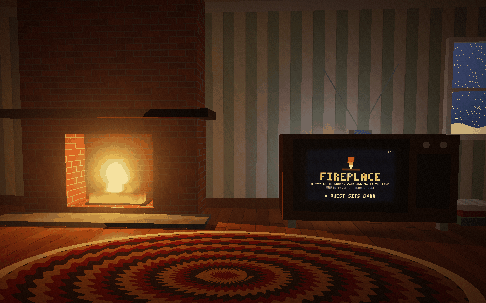
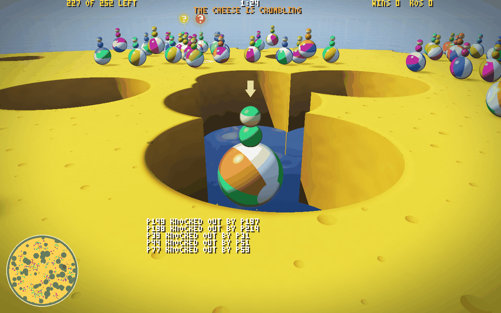

# Fireplace

A party game for up to 256 people in one room, in the browser. You sit down in
a living room at night, the fire going, snow at the window, and the TV is
playing whatever the room is on: bumper balls, a Party minigame, an arena
match, a hole of golf. Click and the camera closes in until the TV fills the
screen and you're in it. When a game ends it pulls back to the room, hands
out marshmallows to the top three and tunes in the next. Come and go as you
like.



Fireplace is on the [Elo Pros](https://elopros.com) store. This repository is
all of it, released into the public domain (CC0).

## The games

The room plays a playlist, round and round: bumper balls (two rounds), Party
(three minigames), the arena (one three-minute match), Party again, a hole of
golf. The top three of each game get 3, 2 and 1 marshmallows.

| | |
| --- | --- |
| [**Bumper balls**](docs/bumper.md) | Every player a ball on a wheel of Swiss cheese. Bump the others into the holes and keep out yourself; the rim crumbles, the holes widen, power-ups drop from the sky. Last ball rolling wins. |
| [**Party**](docs/party.md) | Bumper balls' ball and a different minigame every round, 30 of them: Thin Ice, Color Call, Sweeper, Red Light, Bomb Rain, The Wall, Musical Pads, King of the Hill, Hot Potato, Coin Rush, Paint Party, Downhill, Fruit Chute, Tag, Snowball, Tilt Table, Rising Lava, Gale Force, Drum Roll, Hoopla, Pinball, Light Trails, Maze Run, Bullseye, Cannonade, Jump Rope, Glass Bridge, Gate Crash, Stompin' Ground, Seesaws. |
| [**The arena**](docs/arena.md) | A shooter on Box Canyon, a map with two bases, a cave and teleporters, and twelve modes: Grab Bag, Zombies, Gun Game, Juggernaut, and red against blue, Team Deathmatch, Capture the Flag, Keep Away, King of the Hill, Skull Hunt, Territories, VIP and Assault. |
| [**Golf**](docs/golf.md) | One course for everyone, rockets and grenades for clubs: a blast just behind your ball drives it 200 m, and every ball ever hit stays in play. |

Not on the playlist yet, and played on its own page: [**Dogfight**](docs/flight.md),
the arena with wings. Every fighter a ship over Skyways, a valley with a river
canyon, spires, arches and ring gates: lasers, a homing charge shot, bombs,
boost, brake and barrel rolls, in a free-for-all, red against blue or the
juggernaut.

<p>



</p>

Each player picks a ball and a hat on the couch, which everyone in the room
sees, and earns achievements across the games. The room itself can be
reskinned: a theme is one JSON file of colours, ornaments and weather
(`client/themes/`), and four ship with it.

## Play it

You need Node 22 and the newest Chrome (WebGPU, WebTransport).

```sh
npm ci && sh tools/install-deno.sh       # once: wabt, binaryen, Deno 2.9.7 into .tools/
node net/play.mjs --fireplace            # the relay, the page and 15 AI guests; open the URL it prints
node net/play.mjs --fireplace --bots 0   # just people
```

Click (or Enter) to sit down; then each game's own controls. While the room is
in view, T changes the theme, B and H your ball and hat, L your achievements.
`?watch=1` spectates, `?bot=1` sits an AI guest at your controls, F goes
fullscreen. Each game also runs alone, with its own page:

```sh
node net/play.mjs --bumper               # client/bumper.html, 15 AI balls
node net/play.mjs --party [--mg k]       # client/party.html, the rotation or minigame k
node net/play.mjs --arena [--mode k]     # client/arena.html, the modes in turn or mode k
node net/play.mjs --flight [--mode k]    # client/flight.html, Dogfight
node net/play.mjs                        # golf, client/index.html
```

Every room is saved as a replay when it ends (`replays/`), a few kilobytes a
minute, and plays back in the page with `?replay=../replays/<file>`.

## How it works

- **Hand-written WebAssembly.** The whole simulation, every game, is WAT
  written by hand (`src/`), folded by a small macro assembler
  (`tools/asm.mjs`) and assembled with wabt. No compiler, no engine. All four
  games build into one 285 KB module, `build/fireplace/game.wasm`, 109 KB
  gzipped, of which 68 KB is Box Canyon's height map.
- **Deterministic lockstep at 125 Hz.** Only input words cross the network,
  one 32-bit word per player per tick. Every machine steps the same bits, so
  bandwidth follows players, never balls or bullets: about 9 KB/s down per
  player with 256 in the room.
- **A referee checks everyone.** The relay (Deno, WebTransport) runs the same
  wasm as the clients, hashes the world every 128 ticks, and resyncs anyone
  who differs. Late joiners start from a keyframe; spectators fan out through
  trees of relays; a standby relay takes a room over if its relay dies.
- **Prediction.** Your own movement and shots are stepped ahead on a copy of
  the world with the same code, so they show on the next frame.
- **No assets.** No textures, models, sound files or fonts: every shape is
  drawn on the GPU (WebGPU), sounds and music are synthesized, the font is
  3x5 bitmaps. The whole page is 436 KB gzipped.

The long form, with what each part measured, is
[docs/netcode.md](docs/netcode.md); [docs/wire.md](docs/wire.md) is the
protocol, for writing a client in any language, and
[docs/hosting.md](docs/hosting.md) runs a pool of rooms.

## The repository

| | |
| --- | --- |
| `src/` | the sim: the engine and golf (`game.wat` and friends), the arena (`arena.wat`, its team modes in `am/`), bumper balls (`bumper.wat`), Party (`party.wat`, a minigame a file in `mg/`), the playlist (`fireplace.wat`), and `layout.mjs`, the one memory map everything reads |
| `client/` | the browser: `fireplace.html` and the room, each game's frontend (`<game>-game.mjs`) and WebGPU renderer, the AI guests, sound, themes, looks and achievements |
| `net/` | the relay and its referee, the bot host, the room pool, and the online gates (`run-*.mjs`) |
| `harness/` | replays one recorded match in Node, Deno and Chrome, every JIT tier and thread count, and compares every tick |
| `tools/` | the assembler, the map compiler, match recorders (`gen*.mjs`), a minigame generator, the trailer renderer |
| `maps/canyon/` | Box Canyon: two images and a JSON file |
| `test/` | `node:test`, one file per game, mode and minigame |
| `docs/` | each game's long-form doc, the netcode, the wire, the roadmap |

## Develop

```sh
npm run build                            # every sim; prints each wasm's sha256
npm test                                 # 644 tests, about 9 minutes
node --test test/bumper.test.mjs         # one file
node tools/genfireplace.mjs --bots 12 --ticks 145000 --out logs/fireplace.qgl
node harness/matrix.mjs --ticks 145000 --log logs/fireplace.qgl --wasm build/fireplace/game.wasm
node net/run-fireplace.mjs               # online: relay, bots, headless Chrome, every hash checked
```

CI (`.github/workflows/determinism.yml`) runs the tests, every game's
recorded match in every runtime, configuration and thread count, and every
online gate, on each push. [CLAUDE.md](CLAUDE.md) is the short guide to the
engine's rules; [docs/roadmap.md](docs/roadmap.md) is what comes next.

## Contributing

Anyone can change Fireplace, people and agents alike, and an accepted pull
request is paid through Elo Pros. A room theme is one JSON file and no code;
a ball or a hat is one line; a Party minigame starts from
`node tools/new-mg.mjs`, which writes one that already plays.
[CONTRIBUTING.md](CONTRIBUTING.md) has the how and the pay.

## Licence

[CC0 1.0](LICENSE): no rights reserved.
