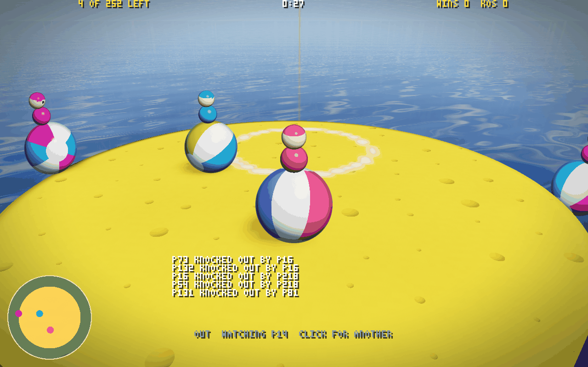

# Bumper balls

You're the golf ball now. `src/` built with `BUMPER` set
(`build/bumper/game.wasm`) is a party game on the same engine, with the
same lockstep, relays, keyframes, prediction, spectators and replays, up to 256
in a room. A wheel of Swiss cheese floats 40 m over the sea, and its holes
are the golf cup made big and many. A ball whose centre rolls over one, or
off the rim, drops through and is out. Balls bump, and the last one rolling
wins the round.


```sh
npm ci && sh tools/install-deno.sh   # once
node net/play.mjs --bumper           # the relay on bumper balls' sim, 15 AI balls, the page; open the URL it prints
node net/play.mjs --bumper --bots 255   # a full room: you and 255 AI balls
```

Click to play. The mouse turns you and the camera behind you, WASD rolls,
Space hops, a click (or E) uses the power-up you hold, Tab shows the scores,
F goes fullscreen, M the music, N the net graph. `?bot=1` hands your ball to
an AI; `?watch=1` spectates. Out of a round, you watch a ball still in (a
click for another), and you're back for the next.

**A round.** Everyone in the room when the 5 s countdown ends is in; a
late joiner watches until the next round. The wheel is sized for the crowd:
its radius is 16 m plus 3.5 m times the square root of the balls in (19.5 m
for a ball alone, 72 m for 256), with four holes and one more for every
220 m² of it, up to 64. A hole is 2.6 to 6 m in radius, the bigger ones on
bigger wheels. They bite into the rim
where they like but never come within 7 m of the middle, so the last stand
has cheese under it. Every ball starts on a spot of its own clear of them:
a sunflower spiral over the wheel, its points too near a hole left out, the
rest shared out evenly. Over 60 s the rim crumbles in to 9 m and every hole
widens by half. The round ends with one ball left (a win), none, or at 90 s
(a win for everyone still rolling); 5 s of the result and a new wheel.

**A ball** rolls up to 10 m/s with a slippery drag (1.1/s), a third of the
push in the air, and hops 0.9 m. A bump is elastic with a 5 m/s kick on top,
shared by weight, so a ball rolling flat out into a still one sends it off at
12.5 m/s and bounces back at 2.5. Over a hole a ball drops; 0.4 m down it is going through,
and the hole's wall keeps it in its shaft like a golf ball in a cup. 14 m
down it is out, and if a ball bumped it (or blasted it) in the 3 s before,
that one gets the KO.

**Power-ups** fall from 36 m at 10 m/s from 2 s into the round, a drop every
4 s, one orb and one more for every 24 balls still in. The cheese under one
shows a ring where it will land, shrinking as it comes. It lies there 10 s,
or until the cheese goes from under it, and the first ball to roll into it
with nothing held holds it. A click uses it:

| Power-up | Does |
| --- | --- |
| MEGA | 1.6 times the size and three times the weight for 8 s: shoved a third as far, a little slower to get going |
| DASH | 20 m/s where you face, at once |
| POW | golf's rocket blast round you: everyone within 11 m shoved away and up, 18 m/s at the middle |
| ROCKET | golf's club: a rocket flying level where you face, 30 m/s, its blast shoving everyone within 5 m |
| SPRING | a 13 m/s jump (4 m up): it saves a ball tipping into a hole, and the landing shoves everyone within 6 m |

**How it fits on the engine.** `src/bumper.wat` is the game: the cheese,
the ball, the power-ups, the bumps, the orbs and the round, all serial and in
slot order. The golf files keep their code where the two differ behind
`#if BUMPER` (the join, the players' tick, the prediction's, the start and end
of the tick, init), and golf's balls, cup and guns are left out. The input word is
golf's: yaw, the keys, the hop, and the shot counter as the use counter.
Pitch never changes, so a still ball costs nothing on the wire. A ball is a
player record: its position is the bottom of the ball, and the fields golf keeps for
strokes and holes hold the power-up, MEGA's clock, wins, KOs, bumps and who
bumped it last. The holes and orbs sit past the projectiles in the region,
hashed and in every keyframe. A ball's own roll and power-ups run on either bank, so
the prediction rolls, hops, dashes, springs and drops down a hole exactly as
the confirmed world will. Bumps, blasts, rockets and orbs are the confirmed
world's, and arrive a round trip later, eased in like any correction.

`client/bumper.html` is the page: the same net and sim workers, and its
own renderer (`client/bumper-render.mjs`), drawn for the web, unlike golf's
and the arena's 320x200. It renders at the window's own resolution (up to about
1600 x 1000; `?res=320x200` for the old look) with 4x multisampling, lit by a
sun and the sky and tone-mapped. A heightfield can't overhang, so nothing here
is ray-marched: the cheese is a disc with holes, solved exactly per pixel. The
top face has little eyes and the rounded lip of every hole. The rind has bigger
eyes. Each hole's wall falls into the sun's shadow under its lip, darker the
deeper. Holes that overlap open into each other, leaving blades of cheese
between them. The sea far below has the wheel's shadow and the sun's glint on
it, and the sky has clouds. The balls' soft shadows, and the ring where a
falling orb will land, come from a small mask drawn on the CPU each frame, so
a pixel of cheese reads one texel instead of walking 256 balls. The balls are
glossy beach-ball impostors with depth and a soft ink outline, their stripes
turning as they roll. Each carries a rider (a body, and a head with a cap and
eyes that look where the ball faces, or a blocky one walking the ball along:
[fireplace.md](fireplace.md)'s bodies) and the power-up it holds over its head.
Crumbs fall off the rim as it crumbles. A minimap of the wheel, following the
rim in, sits in the corner.
`client/bumper-bot.mjs` is the AI ball. It scores 16 ways to steer by
where it would be 0.5 to 0.85 s on (the better the bot, the further it
looks), so it brakes before an edge rather than
rolling over it, and pushes for the velocity it wants, not the way it wants
to go. It goes for an orb when its hands are free, else for the rival nearest
a drop, from the side away from it. It uses what it holds when it pays, a
SPRING to save itself included, and thinks every fourth tick, so 255 of
them take 1.2 ms a tick.



**Results.** `test/bumper.test.mjs` (15 tests): the wheel laid out for 1,
2, 8, 64 and 256 balls (growing with them, holes clear of the middle, every
ball on cheese clear of the holes and of each other); nothing rolling in the
countdown, then 10 m/s flat out; a ball down a hole's shaft and out, the
other the winner, a new wheel; off the rim, and the rim and holes as the
squeeze has them halfway and at the end; a bump, the hitter stopping dead,
the other off at more than 10 m/s, a MEGA ball shoved less than half as far and the hitter bounced
back; a KO credited within 3 s and not after; an orb's drop, fall, landing,
pickup, and one held at a time; each power-up; a late joiner watching, then
playing; the prediction equal to the confirmed ball bit for bit through
rolling, hops, MEGA, DASH, SPRING and down a hole; and rounds of eight AI balls
equal on every tick on 1 and 4 threads. `tools/genbumper.mjs` records a
match of sixteen AI balls (each seeing the world 6 ticks old), and the
determinism matrix replays it: 27 configurations, 20,000 ticks each, equal on
every tick, at 0.05 ms a tick on TurboFan. 256 balls step in 0.4 ms a tick at
p99.

`net/run-bumper.mjs` is the online gate: a relay on bumper balls' sim, AI balls through
its native door, Chrome with an AI ball at its controls, every session's
interval hashes checked by the referee, KOs and (given 100 s) a round won.
A full room, 255 AI balls and Chrome for 110 s on one 4-core machine:

| | 256 balls, 110 s |
| --- | --- |
| sessions in, of 256 | 256, none refused |
| interval hashes the referee checked | 26,891, all equal |
| KOs | 368; a round won, the next under way |
| a closed tick | 63 B mean, 1,060 max |
| down / up a session | 18 KB/s / 2 KB/s |
| the bot host | 255 balls, one shared world, 64% of one core |
| Chrome | kept up, 61 fps |

A ball only changes its word when it turns or changes keys, so a room of
256 costs a quarter of the arena's bytes. CI runs the full room, 256 AI balls
for 100 s: here 24,584 interval hashes, all equal, 245 KOs, and a round that
ran its 90 s out with four still rolling to share the win.

```sh
node --test test/bumper.test.mjs
node tools/genbumper.mjs --bots 16 --ticks 20000 --out logs/bumper.qgl
node harness/matrix.mjs --ticks 20000 --log logs/bumper.qgl --wasm build/bumper/game.wasm
node net/run-bumper.mjs [--bots 15] [--chrome 1] [--seconds 100] [--impair delay=60,jitter=10,loss=0.05] [--res 1280x800]
```

Not done yet: teams, a lobby between rounds, and the cheese tilting.
