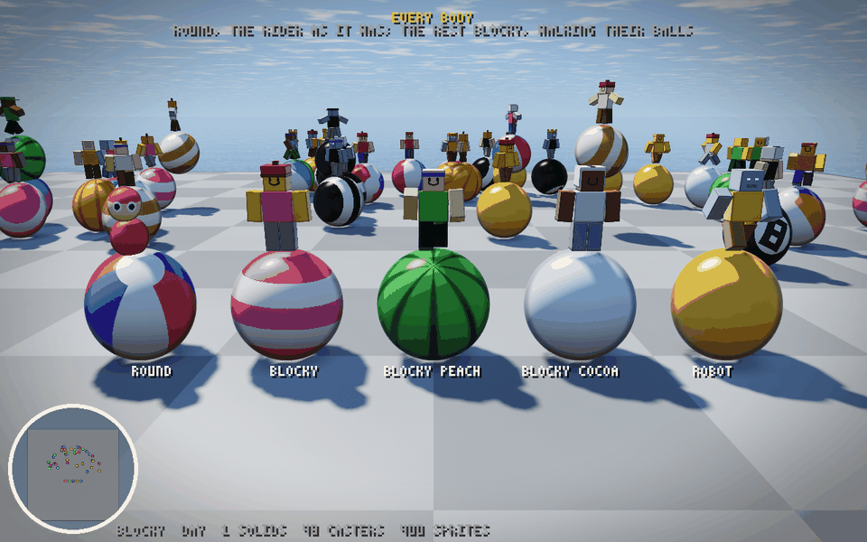
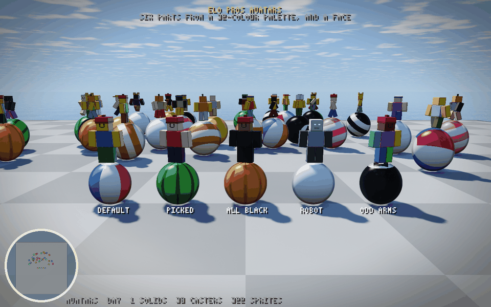
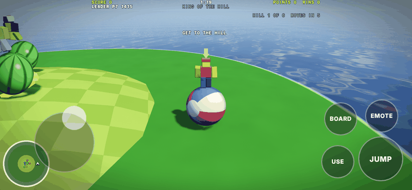
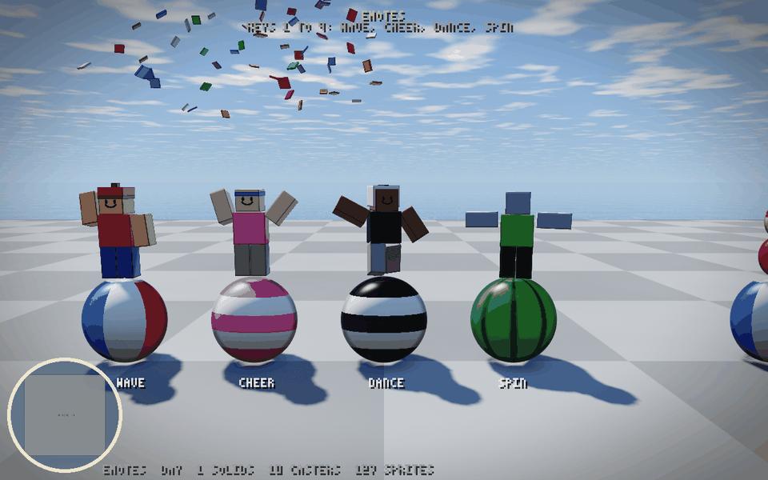

# Fireplace


Grandma's living room at Thanksgiving, everyone round the Atari: the fire
going, snow at the window, a walnut console TV with rabbit ears. Click and you
sit down: the camera closes in on the TV until its glass fills the screen, and
you're in whatever the room is playing. When a game ends it pulls back to the
room, and the TV shows the marshmallows and what's on next; then it closes in
again. The room plays the playlist through: party (three minigames), the
arena (one three-minute match of any of its fifteen modes, drawn for it), party again, a three-minute Dogfight (a free-for-all,
red against blue, the juggernaut or Ring Race, drawn for it), a hole of golf, and round
again; the top three of each game get 3, 2 and 1 marshmallows. Join any time,
into whatever is on (or the next round of it); leave any time.

```sh
node net/play.mjs --fireplace            # the relay on Fireplace's sim, 15 guests, the page; open the URL it prints
node net/play.mjs --fireplace --bots 0   # just people
node net/play.mjs --fireplace --start 3  # from the playlist's entry 3, Dogfight, on
```

Click (or Enter) to sit down; then each game's own controls. `?bot=1` sits a
guest at the controls; `?watch=1` spectates; F goes fullscreen. While the room
is in view, T changes its theme (`?theme=<id>` picks one), B, H and P your
ball, hat and body, and L lists your achievements (`?look=<word>` wears a look
for one visit). In party, 1 to 4 wave, cheer, dance and spin.

**How it fits on the engine.** `build/fireplace/game.wasm` is golf, the arena,
party and flight's Dogfight in one module: `tools/asm.mjs` expands each
exactly as its own build is (the arena on Box Canyon, flight on Skyways, each
its own passive segment), puts its every identifier under a prefix (`$g.`,
`$a.`, `$p.`, `$f.`) and makes its exports internal, and appends `src/fireplace.wat`.
That sends every export to the game on now (the header's `FP_GAME`) and runs
the playlist at the end of each tick. The games are a list, `FP_SETS` in
`src/layout.mjs`: each entry names its prefix and build flags, its world's
generators, how players join it (one by one, or a round laid out at once),
whose input word it reads, its matches and longest match, how it scores and
what its next seed forces, and the `fp` macros (`src/macros.mjs`) write the
playlist's game-by-game code from it. A new game is an entry there and its
row in `client/fireplace.mjs`'s `PAGES` (its frontend, its size, its light).
A game's number is its place on the list and never changes (replays, the
playlist, browsers' achievement tallies and Elo Pros' stats name games by
it), so a game taken out stays as `{ name, retired: true }` and a `null` row:
bumper balls, number 2, whose wheel of cheese is party's SWISS ROLL now.
Moving the five games onto the list left every tick's region hash equal over
a 152,091-tick log through all six playlist entries and back to the first. The ball phases and the barrier are the
same code in every game, so the worker threads never change games. The
playlist goes by position, not by game (`PLAYLIST` in `src/layout.mjs`): the
count of games played (`FP_COUNT`'s high half) mod its length picks the next
entry, so party comes round twice. When a game's last match ends, its result
is scored (golf: strokes; the arena and Dogfight: a Fiesta by kills, then
deaths, any other mode by the places it gives; party: party points, then
minigames won), the marshmallows handed out, the next
entry's seed drawn and the result held 6 s. Then the region is wiped but for
the tick, the PRNG and the playlist's own state, the next game's world is
built on that seed, and everyone in the room is joined into it on that tick
(party lays one round out with everyone in it), keeping their input words
when the two games read the same word (golf's, which party shares; the arena's and Dogfight's are alike but mean other things, so neither
keeps the other's). The seed is a hash of the room's PRNG and the games played (`FP_NEXT`,
`REGION + 0xe400`). The arena's forces a mode: `0xA8` in its top byte, the
mode in the next, drawn by `$rand` from the fifteen (`ARENA_MODES`), never the one the arena
played last (`FP_MODE`, `REGION + 0xe404`), and drawn as the game before ends
so the TV can name it; whatever the mode, the match is cut to 90 s
(`FP_ARENA_TICKS`: Infection loses 90 s, Evade and Escape 2 or 2.5 min, the
rest 3.5 to 8.5 min; Escape's exits, opening 60 s before the clock, open
30 s in), and a team
match cut short goes to the side ahead. Dogfight's forces one of flight's
four modes the same way, drawn by `$rand` (any of them, the last one too)
and cut to 90 s (a race cut short places by gates passed). Golf's hole is
cut to 90 s too, its penalty for anyone not in, so no match in the playlist
runs longer but party's minigames, which keep their own lengths (75 s to
3 min).
Party's keeps its top byte off `0xA7`, which would play one minigame only.
What lasts from game to game (the marshmallows, the arena's last mode, the
next seed) sits in 8 KiB of the region no game touches. A game's static world
(the terrain, the arena's map) is outside the region, so a keyframe from
another game would land on the wrong ground: `FP_WORLD` says which world is
built, and when the region comes from outside, `regrid` stashes it
(`FP_STASH`), builds that game's world under it and puts it back. The map's
area is cleared before any world is built, so Box Canyon's structures past
Skyways' fewer never linger: the static world is the game's and the seed's,
however the sim came to it. A seed whose top byte is `FP_START` (`0xF1`)
starts the playlist at its entry (the next byte), as if the room had played
that many games, for gates and dev (`--start k`). Nothing else
changed: the relay, referee, keyframes, spectators and replays just see a sim.

`client/fireplace.html` is the page. One host (`client/host.mjs`: the memory,
the net and sim workers, the prediction's instance, the sound, one GPU device)
and each game's frontend (`client/party-game.mjs`, `arena-game.mjs`,
`flight-game.mjs`, `golf-game.mjs`) mounted on its own canvas as the room
moves into it, every one at the window's size; `party.html`, `arena.html` and
`flight.html` are the same frontends mounted alone. The net worker packs each tick's word in the format
of the game on now. The room (`client/room-render.mjs`) is solved per
pixel: a few dozen boxes, two pumpkins and the antenna's
rods, lit by the fire (it flickers, and its shadow is cast through the
firebox's mouth), by the TV in the colour of the game on it, and by the snow
light, every colour the theme's. The flames are a short march through the firebox. While the room is in
view the game draws into a texture that the TV shows through a curved CRT with
scanlines and a shadow mask, and those fade as the camera closes in, so the
zoom's last frame is the game as it draws itself; then the page shows the
game's own canvas. The TV's cards (the title, the standings, what's next, the
arena by its mode: "NEXT: ARENA INFECTION") are drawn in the games' HUD font,
on its grid (`client/hudfont.mjs` `drawGlyphs`).
`client/fireplace-bot.mjs` is a guest: a brain for each game (party's is
`client/party-bot.mjs`'s Partier), asked for the one that's on.

**Themes.** A theme is a reskin of the room, local to whoever picks it: one
JSON file in `client/themes/` naming any of the room's 29 colours (the brick,
the wallpaper's stripes, the rug's yarns, the fire, the night through the
window...), the weather at the window (`snow`, `rain`, `clear`) and what
stands on the mantel (`pumpkins`, `baubles`, `none`). It is data, never code,
and only the room's shader reads it (a uniform of its own, `client/themes.mjs`
`pack()`), so no sim, net or other page sees it and a theme can't desync
anything. Grandma's (`grandma.json`) writes out every default: against the
renderer as it was before themes, no pixel of the couch view differs by more
than 2 levels in 255 outside the mantel, where the pumpkins now show (they had
sat inside the brick pillars). `npm run build` checks every file and bundles
them into `build/themes.json` for the picker; the page reads the theme's own
file, so an edit shows on a reload. `client/room.html` is the room alone, for
making one: it reads the file every second and shows a mistake instead of
drawing it. `node tools/theme-shots.mjs` draws each into
`traces/themes/<id>.png` (CI keeps them), and `elo.json` credits each on the
store (`node tools/elo.mjs`). CONTRIBUTING.md is the guide, for themes and
minigames both.

```sh
node tools/themes.mjs new <id> <github-login>   # a theme at Grandma's colours, to edit
node tools/serve.mjs                            # then /client/room.html?theme=<id>
node --test test/themes.test.mjs
```

**Looks.** A look is a ball, a hat and a body a player picks, and everyone in
the room sees it: fourteen balls (the house colours, beach, candy, zebra,
melon, pumpkin, snowball, eight ball, gold, marshmallow, Swiss cheese, ember,
s'more, platinum), eight hats (a cap, a beanie, a headband, a helmet, none, a
pumpkin head, a crown, a flight helmet) and five bodies (the round
rider, blocky with yellow, peach or cocoa skin, a robot), listed in
`client/looks.mjs`. A look is drawing only. The page writes its word
(the ball in the low byte, the hat in the next, the body in the third, an
emote in the top) to `CL_LOOK`, the net worker
sends it on the stream when it changes, and the relay keeps a word a slot and
sends the table to every session that asked for looks in its hello (flag 4),
then what changed, at most every 250 ms (`docs/wire.md`). A slot that empties
goes back to 0, the house look. No tick, record, replay or hash carries a
look, so the sims build to the same sha256 with or without them, and
`tiny-client` and an edge relay, which never ask, never see one. Party
draws the ball's pattern (beach panels, bands, ribs, a solid, metal,
an eight ball's spot) and the hat on the rider's head, a few lines each in
their shaders' ball and head cases; golf and the arena tint the golfer and the
fighter the ball's colour (a team mode's sides still win). Look 0 draws exactly
as the riders always have: the seat's colours, alpha 1, the slot for a seed.
Musical Pads and Paint Party mark what is whose by the seat's colour, so their
balls keep it there (`seatColors`); the hat still shows. The page keeps your
pick in this browser, and a browser that never picked wears the house colours
on a blocky rider (`FIRST_LOOK`); every page with a host wears it, not only
Fireplace's. AI players in a local room wear a look of their own, open ones
on blocky bodies (`guestLook`). `client/party-render-demo.html?scene=wardrobe`
shows every ball and hat, `?scene=blocky` every body, `?scene=outfits` every
hat on one, `?scene=emotes` the emotes.

**Bodies.** A blocky rider (`client/rider.mjs`) is six boxes and its hat's
standing on the ball and walking it along: legs that step as it rolls, arms
that swing against them and go up and out when it flies, a head a size up on
the rest with a face, the shirt in the ball's colour and the legs in its second
colour, darker. A box is a sprite of its own kind (12) in both renderers: the
sprite's square covers the box's bounding sphere, and each pixel casts its own
ray at the box, so a box is one quad, exact at any size, with a bevel and an
ink line on its edges like party's solids. Its pitch rides in the seed, its
yaw in the roll, and a splay about its front in the alpha with its part (a
face, a pumpkin's lit grin, metal, a robot's eyes). The arena's fighters are
the same figure a size up (1.83 m) in its splat shader (`figure`), seven boxes
tested per pixel: legs stepping with their speed, both arms out holding the gun
along the aim, a zombie's reaching empty; the body's skin and face come from
the look word (`looksOf`), the shirt from the tint or the side. Evade's downed
are still the old card on its side.



**Avatars.** A player who signed in with Elo Pros wears the avatar they
picked on their profile there: one word (`client/avatar.mjs`), six parts
(head, torso, each arm, each leg) from a 32-colour palette and a face. The
relay reads it off `/api/face/{wallet}` as the slot signs in and sends it to
everyone beside the looks (hello flag 16, `T_AVATAR`, `CL_AVATARS`;
[wire.md](wire.md)). A blocky rider or fighter wears its colours in place of
the body's skin and the ball's shirt; the hat and the ball stay the look's,
and in a team mode the side's colour stays on the shirt. A local room's AI
players wear avatars of their own (`guestAvatar`); `?avatar=<word>` wears one
for a visit. `?scene=avatars` on the party demo shows a row.



**On a phone.** With a coarse pointer (or `?touch=1`; `?touch=0` never)
every game puts touch controls over its screen (`client/touch.mjs`): a stick
wherever the left thumb lands, which holds W, A, S and D in the game's own
keys; a drag anywhere else to look, through the game's own mouse look as if
the pointer were locked; and round buttons on the right, the first and
biggest in the corner (jump in party, fire in the arena,
golf and Dogfight). The couch gets a bar for B, H, P, T, L and F.



**The font.** Every game's text and the TV's is a bold sans with a dark
outline (`client/hudfont.mjs`): the 3x5 font's 64 characters drawn again at
startup from the system's own sans, a rounded one where there is one, into
an atlas that rides in the renderers' font buffer after the pixel glyphs, so
no shader gained a binding. The text grid is the pixel font's, a character 4
x 6 HUD pixels, so every layout is what it was. Golf's, the arena's and
Dogfight's HUDs are a 320 x 200 grid scaled to fit the window and centred on
it (`client/lowpoly.mjs` `hudFrame`), so their cells are big enough for the
smooth face too. `?font=pixel` keeps the 3x5 font everywhere, and the TV's
text smaller than two canvas pixels a font pixel keeps it anyway.

**Emotes and juice.** 1 to 4 in party wave, cheer, dance and
spin: the look word's top byte, an emote in its low four bits and a count in
its high four, so the same emote twice is a new word the relay passes on. A
page acts one out for 2.5 s from when it sees the word change, and not one it
found there on joining. `client/juice.mjs` is the rest: riders thrown back
with their arms out for 350 ms when their balls meet, the camera shaking when
yours does, and as a round's result is held its winners (place 1: the last
ball, a shared win, a side) cheering under 90 bits of confetti each, boxes
that fall turning. All of it is drawing, from FX and the round's end the
frontends already read.



**Achievements.** Twenty-four, in `client/achievements.mjs`, kept in this
browser: a first game, the top three, a win, two, three and five wins in a
row, 10 wins, first, second and third, 25, 100 and 250 marshmallows, 25 and
100 games, golf, the arena and party each played and each won, all four
with Dogfight played and won, three wins (Big Cheese: it was bumper balls
won, and an achievement's id never changes, only its test), each game won
on its own, and a game
with 32, and one with 100, or more in it. Each is a test over
a tally of results, and a result is what the confirmed world holds while a
game's end is on screen (`FP_STAGE` 1): the game, this slot's place
(`FP_LAST`) and marshmallows (`FP_GOT`), and how many were in it. So every
machine reads the same bits for it; the page counts its own slot's, once per
game (a key of the room, the games played and the game, so a keyframe that
shows the same end again counts nothing). A signed-in player's are kept on
Elo Pros too, where they follow the wallet: the room's relay runs the same
tests for each signed-in slot and reports them ([hosting.md](hosting.md)).
Ten open a look: the pumpkin head (a
first game), the eight ball (the top three), the gold ball (a win), the crown
(two in a row), the marshmallow ball (100 marshmallows), Swiss cheese (three
wins), the flight helmet (a Dogfight won), ember (five in a row), s'more
(250 marshmallows) and platinum (all four games won). Each names its picture
on Elo Pros (`icon`, drawn in scry-forge's
`watchtower/art/achievements/fireplace/`). What one opened shows under the standings, and L lists them on
the TV, six a page. They are this browser's record, not the room's: signing in
with Elo Pros, and the referee's standings as their evidence, come next
(`docs/roadmap.md`).

**Results.** `test/fireplace.test.mjs` (12 tests): the prefixer; the games'
list (`FP_SETS`, a retired entry only its name, a page row for each); one
module with every export; the playlist on the debug build from party
round to party again, the room coming and going (each game's matches:
three minigames, one match cut to 90 s, one hole; everyone in
each new game straight after its switch; Dogfight's match cut to 90 s and
flying the mode its seed forces; no party seed forcing a minigame);
the arena's seed drawn as the party before it ended, and the mode it played;
marshmallows, 3, 2 and 1, by each game's places (party's by points, then wins;
a mode's by its own), summed from game to game and lost with the slot; the
mode's draw (any of the fifteen, then never the last, 100 draws each way), each
mode's match cut to 90 s and placed by the mode; Dogfight's draw (every one
of flight's modes seen in 40 draws), each switched into on Skyways with every
ship in the air, cut to 90 s and placed by its mode; a party seed that came out
with `0xA7` on top turned off it; the playlist equal on every tick on 1 and 4
threads through the first party and the switch into the arena; and keyframes taken
mid-arena, just into the second party, mid-party, mid-Dogfight and mid-golf, each
restored into a sim sitting in the first party's world, its terrain and map
(Box Canyon or Skyways) rebuilt, every tick after
equal to a run that never left; and the achievements' tally fed every held
end of that playlist for three slots, twice each as a page sees a hold, which
counts each game a slot was in once, with its marshmallows and wins.
`test/looks.test.mjs` and `test/achievements.test.mjs` hold the rest: the house
look as the riders were, every pattern and style the lists use present in
party's shader, earned looks naming real achievements, and each achievement's test.
The determinism matrix replays CI's log, 155,000 ticks of twelve guests,
the playlist with the minigames and the modes as they stood before the
arena's, Dogfight's and golf's cut went from 3 and 2.5 min to 90 s:
party, the arena from 263 s, party from 452 s, Dogfight from 630 s, golf from
743 s, and round again (party from 902 s, the arena from 1,110 s): 27
configurations (Node, Deno, Chrome x JIT tiers x 1, 2 and 4 threads), equal
on every tick, at 0.049 to 0.055 ms a tick on TurboFan in Deno and Chrome on
one thread, the region's hash included. Online, `net/run-fireplace.mjs
--bots 15 --seconds 360` on one 4-core machine: 16 sessions (15 guests and
Chrome), the room moved from party into the arena (Territories) at 218 s,
5,630 interval hashes checked by the referee, all equal, 11 bytes a closed
tick on average, 4.8 KB/s down and 2.0 KB/s up a session, each page's look
round every page (`looksWentRound`). Started at Dogfight (`--start 3`,
225 s): 16 sessions, 3,518 interval hashes checked, all equal, the room
through Dogfight into golf at 189 s, Chrome with it and kept up. On
SwiftShader, compiling party's pipelines holds up the page's GPU for about
40 s (measured as the room switched into it); its sim worker and its hashes
carry on, and it catches up. The switch tick costs 30 to 46 ms (measured
with the machine busy) on the relay's referee and every client (most of it
the 512 x 512 terrain each game builds); the sim workers catch up past it.

```sh
node --test test/fireplace.test.mjs
node tools/genfireplace.mjs --bots 12 --ticks 155000 --out logs/fireplace.qgl   # or --games 6: 1500 ticks into party again
node harness/matrix.mjs --ticks 155000 --log logs/fireplace.qgl --wasm build/fireplace/game.wasm
node net/run-fireplace.mjs [--bots 15] [--chrome 1] [--seconds 360] [--res 960x600] [--port 4433] [--start k]
```

## The trailer

Fireplace films itself from a replay. `tools/film.mjs record` runs a room of
guests and keeps its replay; `plan` prints what was on, second by second;
`shoot` draws a cut list (`film/trailer.json`) in headless Chrome. The page
runs with `?replay=…&film=<seconds>`: the replay sits paused, and for each
frame the film moves the sim to the frame's tick (between ticks too, so motion
is smooth), sets the page's clock and draws once. The room's scenes are the
page's own (the couch, the zoom into the TV, the standings between games), run
on that clock at 60 frames a second with every other one kept. The sound is
the game's own, every call made while a shot rolls, rendered in an
OfflineAudioContext on the cut's timeline (`client/film.mjs`), then brought
to -14 LUFS. Captions are drawn in the games' font.

```sh
node tools/film.mjs record --seconds 960 --bots 64   # a replay in replays/
node tools/film.mjs plan replays/<file>.qgr          # each game's span
node tools/film.mjs shoot film/trailer.json --replay replays/<file>.qgr [--stills 2,7.5]
```

The house cut was shot on a 960 s room of 64 guests, which went through the
playlist of the time once (bumper balls, since retired, from 1 s, party from 175 s, the arena's
Juggernaut from 423 s, party from 612 s, golf from 846 s). On SwiftShader at
1280 x 720 a second of film took about a minute to draw. A replay is tied to
the build of `game.wasm` it was recorded on: after a sim change, record again,
plan it and move the shots. `film/trailer.json`'s times are still that
replay's, so the next cut records again first.

`film/flex.json` is a second cut, 1920 x 1080, made of rooms recorded side
by side: `record --start k --port p` starts a room at the playlist's entry k
on its own port, and a shot naming its own `replay` cuts to that room, so
the cut moves between games that ran at once. Its `"guests": true` dresses
every seat as a local room's AI players are, since a replay keeps no looks,
and its `"score"` lays one of the game's tunes under the whole cut in place
of the rooms' own music, its beat 1.024 s, every shot ending on one.

A signed-in player goes by the name their wallet has on Elo Pros, in every
game's labels and the marshmallow board; the relay looks it up and sends it
beside the sim ([wire.md](wire.md)). A guest is P1, P2, ...

Not done yet: a vote for what's next, and a way to lean back from the TV
mid-game.
