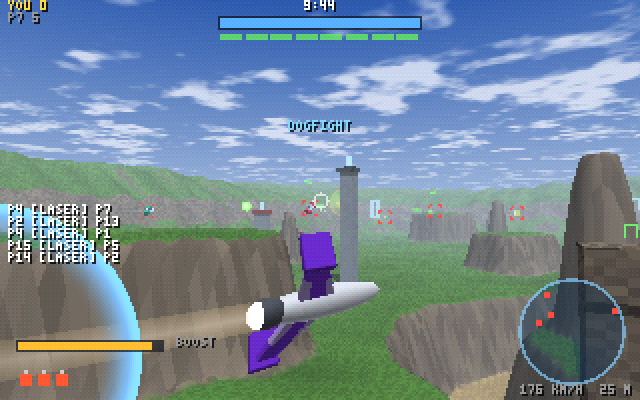
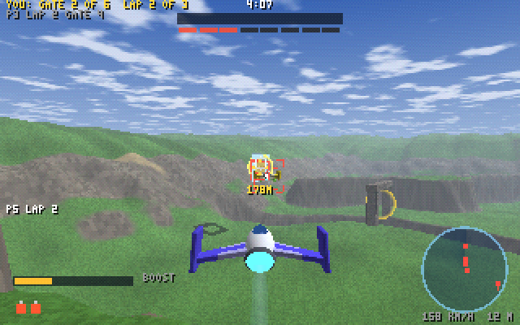
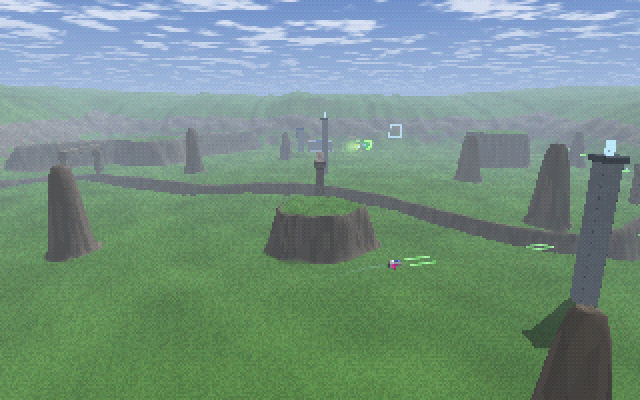

# Dogfight

The arena with wings: every fighter a ship, over Skyways, a valley 640 m
square with a river canyon down the middle, mesas and rock spires, stone
arches and ring gates to fly through, and a hangar at each end. Up to 256
in a room, with the arena's lockstep, relays, keyframes, prediction,
spectators and replays. `src/` built with `ARENA` and `FLIGHT` set
(`build/flight/game.wasm`).

```sh
node net/play.mjs --flight              # the relay on flight's sim, 5 AI pilots, the page; open the URL it prints
node net/play.mjs --flight --mode 4     # every match red against blue
node net/play.mjs --flight --bots 0     # just people
```



Click to fly. The mouse aims and the ship's nose follows it, so the camera
rides behind the ship looking where you aim: a ring at the screen's centre
is the aim, two green squares (30 and 90 m out) are where the nose and the
lasers point; they turn red over an enemy in range. Left click fires lasers
(hold it for as fast as they go). Hold right click (or Space) to build the
charge shot and let go to fire it, once the bar under the boost meter is
full; it homes on the ship nearest your nose. W or Shift boosts, S or Ctrl
brakes, from one meter. Q and E barrel-roll left and right (or A or D
twice quickly); a roll turns lasers away. G, B or the middle button drops
a bomb. Tab the board, F fullscreen, N the net graph. `?bot=1` hands your
ship to an AI pilot; `?watch=1` spectates; `?cam=x,y,z,yaw,pitch` holds a
camera anywhere. More pilots for a running room:
`node net/bot-host.mjs --flight --relay 127.0.0.1:4434 --bots 50`.

Four modes, in turn (`FLIGHT_MODES` in `src/layout.mjs`): three of the
arena's, Dogfight (every ship for itself, ten minutes, the most kills
wins), Team Dogfight (Team Slayer: red against blue, every kill a point for
your side) and Juggernaut (one ship has an overshield and lasers that hit
twice as hard; shoot it down to become it, 10 points wins); and flight's
own, Ring Race (below). A seed that forces any other mode plays a Dogfight.

## Ring Race



Through the map's gates in order, three laps, the first home wins; five
minutes, and when the clock runs out the ships place by gates passed, then
kills. Skyways' course runs clockwise round the map through six gates: the
west ring, the north ring, the arch at z 300, the east ring, the south
ring, the arch at z 724. A ring's gate is a ball of 8 m round its 12 m
opening's centre, an arch's 11 m under its lintel. The guns stay on, so the
race is a fight too. A ship shot down comes back at the last gate it
passed, its nose toward the next. The next gate glows gold and pulses, the
one after it fainter, and a gold diamond over it carries its distance; the
HUD says your gate and lap and who leads, the feed every lap, and the board
GATES, LAP and KILLS. AI pilots fly at their next gate, boosting on the long
legs, and fire only at what is already on their nose: 8 of them finished
three laps in 112 s, the leader about 37 s a lap.

**How it fits on the engine.** Ring Race is flight's own: its number,
`M_RACE` (15), sits past the arena's modes, so the arena's build, whose
`MODES` it never joins, stays bit-identical. Its clock comes from
`FLIGHT_TICKS` (the arena's `MODE_TICKS` and the race's past them) under
`#if FLIGHT` in the match and the prediction; `$a_mode_play` hands it to
`$f_race` before the arena's own modes are asked. A ship's progress is the
gates it has passed, in `MODE_REC`'s points, so the arena's `$a_key` and
`$a_places` place a race as they place Juggernaut, and Fireplace scores it
by that place. The course is the map's: map.json's `race`, `[x, y, z,
radius]` gates in order, compiled into the map's segment only when a map
has one (so Box Canyon's bytes never change) and copied out by flight's
init to `MAP_RACE`.

## A ship

`src/flight.wat`, its constants in `src/flight.mjs`:

| | |
| --- | --- |
| Speed | 34 m/s cruising, 62 boosting, 16 braking; the velocity closes 5% of the gap to the nose's a tick, so a turn drifts |
| Turning | the nose turns toward the aim at 110 degrees a second (77 boosting, 154 braking), pitch within 75 degrees of level |
| Boost meter | 1.6 s of boost or brake; it fills a unit a tick neither is on; run dry, neither works until it is full again |
| Barrel roll | 0.48 s, a 16 m/s throw sideways, lasers that hit a rolling ship are turned away; 0.8 s before the next roll or bomb |
| Shields, hull | the arena's: 100 shields, back 5 s after the last hit, 100 hull under them |
| The ground, boxes | a ship bounces off, losing half the speed into it; more than 5 m/s into it hurts, 0.9 a m/s past that and 5 more |
| The edge, the ceiling | hold it (Skyways' ceiling is 147 m, 70 m over the highest ground) |
| Other ships | two whose centres come within 2.4 m are pushed apart and bounced (40% of the closing speed kept); past 5 m/s closing both are hurt as by a crash, each hit credited to the other, so a head-on at the cruise costs each 61; allies only bounce |

| Weapon | Fires | Damage | Notes |
| --- | --- | --- | --- |
| Lasers | 11.4 a second, held | 9 | hitscan, 260 m, lag-compensated as the arena's guns are; drawn as twin bolts from the wingtips |
| Charge shot | held 0.6 s, let go | 70 splash over 7 m | 95 m/s, locks on to the enemy most ahead within 20 degrees and 260 m, turns 10% a tick toward it, 2 s of flight |
| Bomb | G, three at a spawn, a kill gives one back (up to four) | 170 splash over 20 m | the ship's speed and 40 m/s more, goes off on a ship, the ground or a box, or after 0.8 s; half to yourself |

**How it fits on the engine.** Flight is the arena build with
`#if FLIGHT` round the few places that differ: `$move` hands a ship's tick
to `$f_move`, the projectile loop hands charge shots and bombs to
`$f_proj`, `$a_spawn` ends by lifting the ship into the air
(`$f_spawn`), a juggernaut keeps its record (`$a_turn` arms it with
nothing), there are no weapon pads, and the match picks from
`FLIGHT_MODES`. Everything else (spawns, damage, kills, respawns,
shields, sides, scores, the match's clock, `HIST` and the view lag in
the word's frames) is the arena's, untouched, and the arena's own build
stays bit-identical. The word is the arena's with flight's meanings: yaw
and pitch where the pilot aims, forward and back boost and brake, left
the side a roll goes, jump the charge held, melee's bit a roll, grenade's
a bomb, the trigger's counter lasers. A ship's own state (its nose's yaw
and pitch, the meter, the roll, the charge) sits in the eight bytes the
arena's guns take in the record (`F_*` in `src/flight.mjs`); its position
is its centre. A ship is a ball of 1.8 m for shots and blasts and 1.2 m
against the ground and boxes. Like the arena's, `$f_move` runs on either
bank and writes only its own record, its own projectiles and its bank's
FX ring; damage, including a crash's, is the confirmed world's. In the
countdown a ship waits where it came in, its nose turning, so a word of 0
(nose down) can't fly it into the ground before its pilot's first word
arrives.

`client/flight.html` is the page, `client/flight-game.mjs` the frontend
and `client/flight-render.mjs` the renderer: golf's and the arena's look
(the terrain ray-marched per pixel, boxes ray-traced with their shadows,
the 3x5 font) through a camera with a full basis rather than a yaw and a
sheared pitch, so it can look straight down a dive. Each ship is
ray-traced in a quad round it: a distance field of a fuselage, a canopy,
swept wings, fins at the tips and an engine, in the ship's own frame,
banked into the turn its pilot asks for and spun through a roll, its
engine white while it boosts. Your own ship is the prediction's. The HUD:
shields and hull, the boost meter, the charge, bombs, brackets on the 32
nearest ships (the lock in yellow), a radar of 300 m, a kill feed, PULL UP,
TURN BACK and the board. The map's edge shows as a red grid as you near
it. `client/flight-bot.mjs` is the AI pilot: the nearest enemy, a settling
aim, lasers with its nose on, a charge now and then, a bomb into two or
more ahead, boost to close and brake not to overshoot, a swerve from a
ship whose closest approach in the next 0.8 s is under 6 m, a roll when
hit, and under it all the ground looked for 85 m ahead, the ceiling and
the edge.

Ships meeting is the one thing here that touches two records, so it is the
confirmed world's alone: `$f_collide`, serial at the start of the arena's
end-of-tick pass (before everyone's place goes into `HIST`), pairs in slot
order. The prediction never moves your ship off another's body; a
collision's bounce reaches its pilot a round trip later, as a blast's push
does in the arena.

**Results.** `test/flight.test.mjs` (13 tests): the sim's exports and
Skyways' bounds, boxes and ceiling; a spawn (in the air, its nose level
toward the middle, the meter full, three bombs) and the countdown's wait;
the turn rates, the pitch limit and the cruise; the meter running dry and
filling; the ground bouncing a dive and hurting, the ceiling and the edge;
lasers through shields and hull to a kill, every shot a hit, and a roll
turning them away; a laser landing where its shooter's frames say it saw
its target 12 ticks before; a charge shot homing onto a target 12 degrees
off the nose, one let go early firing nothing, and a bomb; the modes in
turn and a juggernaut's nose kept; two ships head on at the cruise never
passing through each other, each hurt about 61 at the first meeting and
bounced, each hit credited to the other, a gentle touch hurting nobody, and
two of one side only bouncing; Ring Race on Skyways' six gates as map.json
lists them, a gate out of order counting for nothing, news for every gate
and lap, three laps to a win, the match over and placed by gates passed,
and a ship shot down coming back at its last gate facing the next; the
prediction equal to the confirmed
ship bit for bit through turns, boost, brake, a roll, lasers, a charge
shot and a bomb; and eight AI pilots shooting each other down, equal on
every tick on 1 and 4 threads. `tools/genflight.mjs` records a match and
the determinism matrix replays it: 27 configurations (Node, Deno, Chrome x
JIT tiers x 1, 2 and 4 threads), 20,000 ticks each, equal on every tick, at
0.05 to 0.3 ms a tick on TurboFan. `net/run-flight.mjs` is the online gate:
a relay on flight's sim, five AI pilots through its native door and Chrome
with a pilot at its controls; in 30 s, 6 sessions, 174 interval hashes
checked by the referee, all equal; 7 bytes a closed tick on average, about
4 KB/s down and 2 KB/s up a session. CI runs it full:

| | 256 pilots, Dogfight, 40 s |
| --- | --- |
| sessions in, of 256 | 256, none refused |
| interval hashes the referee checked | 9,481, all equal |
| shot down in the 40 s | 1,146 |
| a closed tick | 225 B mean, 662 max |
| down / up a session | 61 KB/s / 2 KB/s |
| a tick of the bot host's shared world | 0.16 ms mean, 3 ms worst |

Forced to one mode, 64 pilots for 60 s each: Team Dogfight 3,702 hashes all
equal, 32 pilots a side, 162 to 177; Juggernaut 3,701 all equal.

Pilots on Skyways, 16 for 12,000 ticks: 55 shot down by lasers, 19 by
charge shots, 22 by bombs, 3 by meeting another ship (23 of 144 before the
pilots learned to swerve); median height over the ground 37 m, median
speed 33 m/s. The match recorded for the matrix is 2 MB for
160 s: a pilot's aim moves every tick, so its word does too.



## Skyways

`maps/skyways/`, drawn by `tools/skyways.mjs` as `tools/canyon.mjs` drew
Box Canyon (a map is still a paint program and a text editor away): the
bounds 640 m square, the images 340 x 340 samples round them. A valley
floor at 30 m, hills climbing from 50 m inside the edge; a river canyon
24 m deep winding north to south, spanned by three stone arches; five
mesas and eight rock spires up to 74 m; a ridge across the north-east with
a notch to fly through; four ring gates with 12 m openings; two radio
towers 57 m tall; a hangar you can fly into and a control tower at each
end, red west and blue east. 47 boxes in 11 groups, 32 spawns mirrored
across the middle, the ceiling 147 m (map.json's `ceiling`; a map without
one gets 60 m over its highest ground inside the bounds). Heights are kept
to an eighth of a metre so the image packs: flight's wasm is 400 KB,
100 KB gzipped, 80 KB of that the map. Flight always builds on Skyways
(`FLIGHT_MAP`); `--map` and `QG_MAP` still choose only the arena's.

Dogfight is on Fireplace's playlist too ([docs/fireplace.md](fireplace.md)):
a three-minute match of a mode drawn for it, between party and golf, in
`build/fireplace/game.wasm` under the prefix `$f.` with Skyways as its own
segment.

Not done yet: more maps and modes (capture the flag in the air), and a
frame rate on a real GPU.
