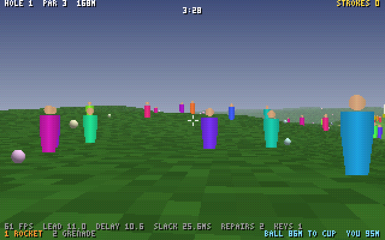
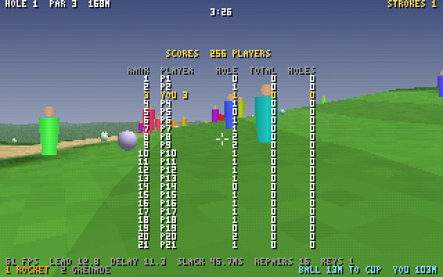

# The engine and the netcode

Every game in Fireplace runs on one engine: a sim written by hand in
WebAssembly, stepped in deterministic lockstep at 125 Hz, so only inputs
cross the network and every machine computes the same bits. This page is how
it fits together and what it measured; [wire.md](wire.md) is the protocol for
writing a client of your own, and [hosting.md](hosting.md) runs rooms.

## How it fits together

- `src/*.wat` is the sim, written by hand. `tools/asm.mjs` is the macro
  assembler: it folds `@LAYOUT` constants into memory operands, expands
  `(!macros)` from `src/macros.mjs`, strips debug-only asserts from release
  builds, and refuses what the determinism rules ban (relaxed SIMD,
  `memory.grow`, data segments, mutable globals). wabt assembles the result.
- `src/layout.mjs` is the one memory map: a 512 KiB region hashed in 128
  slices, scratch outside it, terrain regenerated from the seed.
- Contacts are Jacobi: phase A reads only start-of-tick state, phase B writes
  only its own balls, so any split across threads gives the same bits. The
  tests run random splits in shuffled order and real 2- and 4-thread runs.
- Balls find each other through a 64 x 8 x 64 grid of 0.4 m cells that wraps,
  kept outside the region from tick to tick: each bucket is a list of its
  balls in ascending index, and only the balls that moved change bucket, at
  the end of the tick that moved them. The lists are a function of the
  region alone, however they were reached, so the sim rebuilds them whole
  whenever the region came from somewhere else (`init`, `restore`, a tick or
  ball count it was not kept for, or the `regrid` export, which anything that
  writes the region from outside calls).
- `harness/` replays one event log in Node, Deno and a Chrome worker and
  records a hash of the whole region every tick. `tools/compare.mjs` names the
  first tick that differs and which slice and field it was in.
- `net/relay.ts` is the relay: one isolate owns the QUIC sessions, an 8 ms
  clock from a fixed epoch, and the bundles (the newest four ticks every second
  tick, with a per-recipient trailer). Each closed tick is coded once, as the
  input words that changed since the tick before, each a delta from that
  player's last word, bit-packed (`net/wire.mjs`, wire v4); bundles, repairs,
  fills and the record all carry ticks in that form. It records every closed tick from the room's
  start and hands it to the referee, `net/referee.mjs` in a Worker: the same
  game.wasm stepping the room, the truth for interval hashes and keyframes.
  A joiner gets the newest keyframe and the record since it. A tick a
  client's per-tick acks lack comes back in a repair datagram. A client whose
  interval hash differs from the referee's gets the keyframe again, with the
  referee's slice digests so it can name the slice, and the room's record is
  saved as a .qgl that replays the desync. An emptied room starts over on a
  new seed.
- The record does two more jobs. A replay (`net/replay.mjs`) is the record
  written out with the referee's hashes, and playing one is being a client
  with the network taken away (`client/replay.mjs` stands in for the net
  worker). An edge relay keeps a record and a referee of its own, so one
  started with `--standby` can take the room over when its upstream dies:
  it closes the next ticks on the old clock's timeline, and holds each
  player's slot with a ghost that repeats their last word until they come
  back with a resume.
- Gameplay is in the sim too, all serial and in index order: `players.wat`
  (Quake movement, shots on a shot-counter advance, pushes on other players'
  balls), `weapons.wat` (rockets marched in half steps, bouncing grenades,
  blasts on balls and players), `hole.wat` (the slipgate cup and the hole
  clock) and `terrain.wat`, which lays out a hole per seed: tee, fairway,
  rough, bunkers and a flattened green. Inputs, joins and leaves are inbox
  records (`net/inbox.mjs` is the one way a closed tick becomes them), so a
  match is an ordinary event log the harness replays.
- Every player and projectile access is a constant offset plus a record
  address plus a bank offset: 0 for the confirmed world, `PRED_D` for a copy.
  `predict.wat` copies the header, players and projectiles there and steps one
  player and only its projectiles through pending inputs with the same code a
  confirmed tick runs, writing nothing else. With nothing remote in the way it
  matches what the confirmed world later does, bit for bit.
- `client/` is the browser game on three threads over one shared memory. The
  net worker owns WebTransport and two clocks (`client/clock.mjs`): the
  predicted one, the server's tick plus an input lead sized from the relay's
  jitter, on which it samples one input word a tick; and the playout clock,
  2 ticks plus the p95 jitter of first arrivals behind the earliest, run up to
  3% fast or slow. It acks every tick and unpacks keyframes. The sim worker
  steps confirmed ticks to the playout clock, restores keyframes, reports
  each interval's hash and asks for a resync when a hole outlives the repair
  window or it falls 2 s behind. The main thread reads raw mouse and keys,
  rebuilds the prediction every frame on its own instance of game.wasm (the
  sampled inputs, then the tick in progress with the input as it is now),
  eases corrections in over 100 ms, and draws with WebGPU straight from
  shared memory: the terrain ray-marched per pixel at the window's size
  (`?res=`), bodies as splats, your own player and shots from the
  prediction, a HUD on a 320 x 200 grid scaled to fit.
  `?bot=1` hands the controls to `client/bot.mjs`, which plans every shot on a
  private copy of the sim.
- `net/relay.ts` also has a native door, `--native-port` (4434): the same
  session with a TCP connection for the stream and UDP for the datagrams,
  each of the client's prefixed with a token from the welcome. Native and
  browser players share rooms; the bot host and `net/tiny-client.mjs` come in
  this way.

## 256 players in one room

`node net/run-n1.mjs` fills one room to all 256 slots: Chrome clients (the
golf bot at one's controls, the bred golfer at the other's) and the bot host
(`net/bot-host.mjs`) with the rest, each a golfer on its own session over the
relay's native door. Every datagram both ways has a 100 ms round trip, 15 ms
jitter and 5% loss. Once the room is full, one more player knocks.

Wire v4 is what makes it fit. A tick no longer carries a word for every slot:
the sim keeps a player's last word until a new one comes, so a tick carries
only the words that changed, each coded against that player's previous word
(a yaw and a pitch delta in Exp-Golomb codes, and the button byte only if it
changed), and the slots between them as gaps. A tick too big for one datagram
(256 players' worth of random noise is about 1.6 KB) is cut by slot into
parts, each decodable on its own. Each tick is coded against the one before,
which costs a lockstep client nothing, since it can't step past a missing
tick anyway; a joiner's base is each live player's last input in the
keyframe's region, so keyframes didn't change. The relay codes each tick once,
whoever receives it.

The bot host shows the other half: every client of a room computes the same
world, so one process can play 252 slots from a single copy of it. It steps
the room from whatever ticks any of its sessions hears, and its golfers read
that one world. Each session still acks, gets its own repairs, keeps its own
input lead and reports the world's interval hashes, so to the relay they are
252 ordinary clients.

| 256 players, 90 s, 100 ms round trip, 15 ms jitter, 5% loss each way | |
| --- | --- |
| the room | 256 sessions at once; the 257th turned away as full |
| interval hashes vs the referee's | 20,738 of 20,739 reports equal; the other was a bit flipped on purpose. Chrome 89 of 89 each, the bot host's world 83 of 83 |
| a flipped bit | caught at the interval closing at sim tick 5,760 and healed by its desync keyframe |
| the late join | slot 255, from a keyframe of the full room at sim tick 3,712, 86 ticks to fast-forward |
| a tick, coded | 26 B on average, 151 B at most |
| a bundle | 145 B on average, always one datagram (the largest 348 B) |
| per session | 9.0 KB/s down, 4.9 KB/s up |
| ticks heard by bundle | 99.75% (two bundles a tick at 5% loss give 99.75%), the worst session 99.54%; repairs brought 12,607 ticks in 5,226 datagrams |
| inputs applied as sent | 99.34% (1.5% of words late, repeated) |
| the relay | 54% of a core: 256 sessions, about 16,000 bundles and 16,000 input datagrams a second |
| the bot host | 55% of a core for 252 golfers: one sim, 0.18 ms a tick; 725 strokes in 90 s |

What a bundle costs, the same runs before and since:

| | wire v3: a word for each of 64 slots, every tick | wire v4: the words that changed |
| --- | --- | --- |
| 3 players | 1,052 B, 65 KB/s each | 41 B, 2.6 KB/s |
| 64 bots that move their aim every tick | 1,052 B, 65 KB/s | 513 B, 32 KB/s |
| 256 players | could not: 64 slots | 145 B, 9.0 KB/s |

CI runs the gate without Chrome (256 golfers) on every push.

Not done:

- **Rooms in one process.** One relay runs one room; a machine runs many as
  a pool of relays (`net/rooms.mjs`, [hosting.md](hosting.md)), and several
  rooms in one process across isolates come next. (Failover is
  [below](#failover-and-replays).)

## Spectators

A room's ticks are the same for everyone, so a spectator is a client that
holds no slot: it says so in its hello (a flag byte), the relay welcomes it as
watching (`T_WATCHING`) and sends it what it sends a player, the bundles,
repairs and keyframes, and checks the interval hashes it reports. It sends no
words, so it costs the room nothing: no slot, no input in any tick.

An edge relay (`net/relay.ts --upstream host:port`) is a spectator of another
relay's room that serves it on to spectators of its own. It closes each tick
as it comes down rather than on its own clock, so its bundles and repairs are
its own. Its referee starts from the keyframe it began watching at (the record
is change-coded, so it seeds the tick base from that keyframe's region) and
reports its interval hashes upstream like any spectator: each relay in a tree
is checked by the one above it, and a relay that drifts is resynced by it. An
edge takes no players; one that asks is turned away (`REJECT.WATCH_ONLY`).

`node net/run-n3.mjs` builds the tree: the root relay holds the room and the
bot host's 128 golfers play it; edges A and B watch the root and C watches A,
two levels down. Each edge serves 200 spectators from a bot host in `--watch`
mode, each its own session, and C a Chrome tab too (`?watch=1`). Every
spectator's link has a 100 ms round trip, 15 ms jitter and 5% loss; the links
between relays have none. At the end, a player knocks at an edge.

| 60 s, 128 golfers, 3 edges, 601 spectators, 100 ms round trip, 15 ms jitter, 5% loss | |
| --- | --- |
| the root | 128 players and 2 spectators (edges A and B); 9,462 of 9,462 hash reports equal its referee's; 59% of a core |
| the edges' referees vs the one above | A 70 of 70, B 70 of 70, C (two down) 67 of 67; no resync, no repair upstream |
| each edge | 200 spectators (A also serves C); every report equal (9,600, 9,508, 9,579); 47% of a core |
| the spectators | 600 joined from their edge's keyframe, none turned away; each host's world hashed as the root's, 49 of 49 |
| the Chrome spectator on C | watching P1 two relays from the room; 59 of 59 interval hashes equal |
| per spectator | 5.3 KB/s down; 99.6% of ticks heard by bundle (two bundles a tick at 5% loss give 99.75%) |
| a player at an edge | turned away: spectators only |
| the hosts | 24% of a core for 200 spectators, one shared world |

CI runs a smaller tree without Chrome (64 golfers, 100 spectators an edge) on every push.

## Failover and replays

A room lives in one relay's record, and an edge relay keeps a copy of that
record with a referee of its own. So an edge can take the room over. Start one
with `--standby`, and if its upstream dies it closes the next ticks itself,
from the newest it has, on the old clock's timeline. Every tick number and
every client's clock stay as they were.

Each player in the world keeps their slot. A ghost holds it, repeating their
last word as the relay does for a player whose inputs are late, until they
reconnect with a resume (a hello flag, their slot and the room). They get the
slot back with no join, then a keyframe.

Clients given several relays try the next when theirs goes quiet: Chrome, the
bot host and edge relays. 1.5 s without a datagram counts as quiet, since a
dead QUIC peer would idle for far longer. An edge given several upstreams
follows the next one in the same way.

The same record is the replay. A relay started with `--replays` writes each
room to a file when it ends: the closed ticks as the wire codes them, plus the
referee's interval hashes. A file plays in the page (`?replay=`) and in
`tools/replay.mjs`, and both check every interval against the referee's as
they go. A replay is proof as well as a recording: change one tick and every
interval after it says so.

`node net/run-n4.mjs` sets it up:
- **The relays:** the root holds the room; a standby watches it; edge B
  watches the root, or failing that the standby, and serves 64 spectators.
- **The players:** 64 golfers from the bot host and a Chrome client with the
  golf bot, all of them told about the root and the standby.
- **The kill:** 25 s in, the root gets SIGKILL, so it says no goodbye.
- **The replay:** when everyone has left, the standby writes the replay. The
  gate checks it, then plays it in Chrome at 8x.

| 60 s, 65 players, the root killed at 25 s, 100 ms round trip, 15 ms jitter, 5% loss | |
| --- | --- |
| the takeover | at sim tick 2,949, 3 ticks behind the dead root's clock, with 65 slots held |
| the players | all 65 back in their own slots, none joined again; the slowest golfer back in 278 ms, Chrome within its 1.5 s of silence |
| hash reports at the standby | 2,015 of 2,015 equal its referee's; the golfers' world 54 of 54 and Chrome 51 of 51 through the takeover |
| edge B | followed the standby; its referee 54 of 54 equal to the standby's, its 64 spectators' reports all equal |
| the replay | 37 KB for 56 s of 65 players, from sim tick 0 to the end, across both relays; 54 of 54 intervals equal, in Node and in Chrome |

The first runs found a race. When the root's stream ended, the standby closed
its socket at once and lost the root's last bundle, which the players had
already received. It then closed those ticks again in its own way. Now an
edge reads its socket for 100 ms more before it takes over. A failed-over
client also restores the new relay's keyframe, so even a tick the standby
never got can't split it from the room.

CI runs a smaller room (32 golfers, the kill at 15 s) on every push.

Not done:

- **Trusting a resume.** A standby gives a held slot to whoever asks for it
  first, as a relay already gives a free slot to whoever joins. A ticket the
  relays share would bind a slot to its player.

## Measured

Measured in a 4-core cloud container on 2026-10-18. When the harness first
passed, golf's game.wasm (sha256 `42a59430…`) was 6,401 B, 3,200 B gzipped; Binaryen `-O3` makes it 5,923 B
but 3,220 B gzipped, so the hand-written build ships as is.

**Determinism.** One 1M-tick log (10,000 balls, ~600 awake, a blast
every 24 ticks, a wake storm every 2,000) replayed in Node 22 (V8 12.4),
Deno 2.9.7 (V8 15.0) and Chrome 141 (V8 14.1) on 4 threads: every tick's
region hash agrees. At 100k ticks all 27 configurations agree: each runtime,
default / Liftoff only / TurboFan only, 1, 2 and 4 threads.

| Confirmed tick, 10,000 balls, ~600 awake | ms |
| --- | --- |
| one thread, Node (tick_begin 0.11, contacts 0.26, integrate 0.04, tick_end 0.01) | 0.41 |
| p99 tick (two runs) | 0.68–0.84 |
| one thread, Chrome / Deno | 0.31 / 0.34 |
| Liftoff only (Chrome) | 0.96 |
| budget | 1.5 |

At ~600 awake, threads do not help: three barriers a tick cost about what
the split saves. With ~2,900 awake (a large blast every 8 ticks) one thread
takes 1.51 ms, at the budget, while 2 threads take 0.98 ms and 4 take 0.77 ms.
`node harness/perf.mjs` prints all of this.

Those are the first harness's numbers. Golf's rolling (a fixed slowdown per surface, and
rough wherever there is no hole) settles balls sooner, so the same log now
keeps ~127 awake: a tick takes 0.18 ms on one thread (p99 0.40), and the
storm keeps 1,359 awake at 0.71 / 0.55 / 0.51 ms on 1 / 2 / 4 threads. The
matrix still agrees in all 27 configurations. The worst case, a grenade
into a 10,000-ball pit, is the benchmark now (`node harness/perf.mjs`).

**The relay.** 63 bots and one client, each a WebTransport session in a
Chrome worker, against the Deno relay on loopback for 60 s:

| | clean | 40 ms RTT, 10 ms jitter, 5% loss |
| --- | --- | --- |
| largest bundle (limit 1,161 B) | 1,052 B | 1,052 B |
| ticks delivered | 100%, every client | 99.745% (expected 99.75%), worst client 99.44% |
| inputs applied as sent | 99.92% | 99.40% |
| bundle jitter p50 / p95 / p99 | 0.23 / 2.6 / 6.9 ms | 2.5 / 5.4 / 9.3 ms |
| tick close lateness p50 / p99 | 0.001 / 3.8 ms | 0.002 / 3.5 ms |
| per session, down / up (payload) | 65 / 1.5 KB/s | 65 / 2.7 KB/s |
| relay CPU | 39% of a core | 41% of a core |

Chrome reports a 1,024 B `maxDatagramSize`, which only limits what it sends;
it receives the 1,052 B bundles fine. (Those were wire v3's bundles: since
wire v4, [above](#256-players-in-one-room), the same 64 bots' bundles are 513 B.) The relay's cost is per packet in Deno's
QUIC path (~8,000 packets a second per room); the referee sim is about 5% of a
core. So packets set rooms per core: about two today. BBR
(`congestionControl: "low-latency"`) and the default controller measured the
same.

The tail is this VM, not the relay. Closes ran 30-70 ms late a few times a
minute even with no clients connected. Two causes:

- V8's parallel scavenger waits on helper threads, and idle vCPUs here wake
  slowly, so a 0.3 ms scavenge took up to 69 ms. The relay runs with
  `--v8-flags=--single-threaded-gc`; a Node timer loop goes from 28 ms gaps to
  none with it.
- A thread sleeping on a timer also wakes late. Spinning instead of sleeping
  (`--early 9`) takes an idle relay from a 54 ms worst case to 18 ms, but under
  load it barely helps and costs a whole core, so the relay still sleeps.

Across seven 60 s runs the close-lateness p99 ranged from 1.0 to 3.8 ms.
