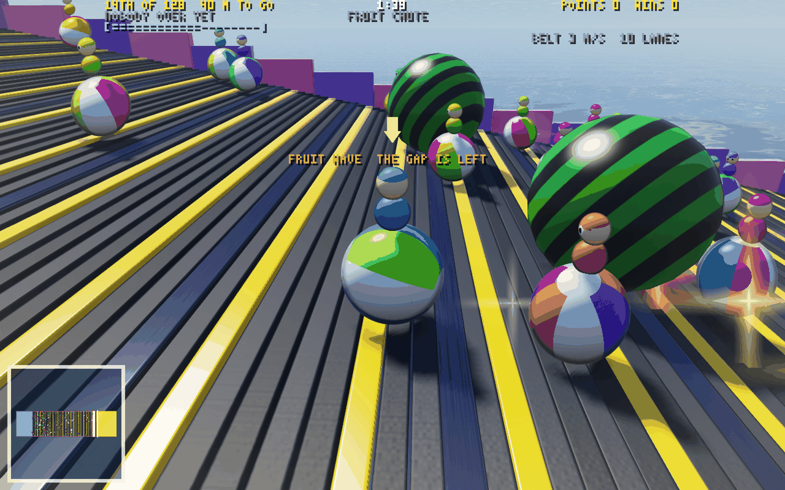

# Party



Bumper balls' ball, and every round a different minigame: thirty-one of them,
after Mario Party, Mario Kart's battle mode, Fall Guys, Squid Game and Roblox, up to 256 in a room.
`src/` built with `BUMPER` and `PARTY` set (`build/party/game.wasm`), with the
same lockstep, relays, keyframes, prediction, spectators and replays.

```sh
node net/play.mjs --party               # the relay on Party's sim, 15 AI balls, the page; open the URL it prints
node net/play.mjs --party --mg 3        # every round Red Light (a minigame's number, below)
node net/play.mjs --party --bots 255    # a full room
```

The controls are bumper balls': the mouse turns you, WASD rolls, Space hops,
a click uses what you hold, Tab shows the standings. A round is a 6 s title
card (the minigame's name, how it plays, how it's won), the round, and 5 s of
its result; the next minigame is drawn from the room's PRNG, never one of the
last two. A win is 10 party points and last place 1, in even steps between;
the standings are party points, then wins. `?bot=1` hands your ball to an AI;
`?watch=1` spectates.

| # | Minigame | Won by | How it plays |
| --- | --- | --- | --- |
| 0 | THIN ICE | last one in | three floors of hex ice; a tile cracks under your ball and drops 0.64 s later; fall through all three and you're out |
| 1 | COLOR CALL | last one in | hex tiles in 4 or 5 colours; a colour is called, 2.6 s shrinking to 1.2 s, then every other colour drops for 1.5 s; from the 5th call the outer ring goes for good, from the 18th only the one called tile holds |
| 2 | SWEEPER | last one in | bars sweep round from a post at ball height, faster every second; hop them; a second bar at 16 s, a third at 36, a fourth at 56, each one reversing them; the outer rings drop from 66 s |
| 3 | RED LIGHT | finishing order | 170 m to the line past a giant doll; roll while she sings, and 0.35 s after she turns, anything faster than 1.2 m/s is caught; bumps are on until she looks, without bumper's kick once red starts |
| 4 | BOMB RAIN | last one in | bombs fall where a ring on the floor says, half of them aimed at a ball; big ones blow craters in the tiles; the rim crumbles in to 10 m |
| 5 | THE WALL | last one in | walls with gaps sweep across a square stage and carry off what they meet; faster, fewer gaps, and from 40 s every other wall sways |
| 6 | MUSICAL PADS | last one in | the music stops, pads light up, half as many as balls left; 4 s later everyone not on a pad is out; a gold pad pays a power-up |
| 7 | KING OF THE HILL | points | a hill swells out of the floor every 15 s, its top zone shrinking; a point a tick on it, two on the crown; two hills from 48 balls, three from 128 |
| 8 | HOT POTATO | last one in | a bomb for every three balls; touch someone to pass it; a holder rolls 15% faster; the fuse is 12 s, a second shorter each wave |
| 9 | COIN RUSH | points | coins rain on a pinball disc; take one by touching it; a hard bump knocks up to 3 of yours loose, a fall spills half; jackpots called 3 s ahead; a frenzy for the last 15 s |
| 10 | PAINT PARTY | points | a 256 x 256 grid of cells; every cell you roll over is yours until someone rolls over it; paint bombs burst 4 m round; the last 10 s paint wider |
| 11 | DOWNHILL | finishing order | 450 to 600 m of track from 100 m up: drops, banked bends, a jump over a gap, a funnel, bumpers, spinners and sweepers, boost pads and power-up boxes |
| 12 | FRUIT CHUTE | finishing order | a 100 m conveyor rising 20 m carries everyone down at 3 m/s while grapes, apples, oranges and melons roll down its lanes |
| 13 | TAG | points | one it for every 16 balls; an it that touches you makes you it; a point a second free; springs for the free, dashes for the its |
| 14 | SNOWBALL | last one in | every ball a snowball, 1 to 3 m, on a snowfield whose rim crumbles in to 7 m; fresh snow grows you 1.5 cm a metre, tracks packed 2.4 s after a ball rolls them wear you down, standing still melts you; big is heavy, slow to start and quicker flat out; touch a ball under 3/4 your size and you swallow it, a line that rises to any smaller ball by the clock, when all but the biggest melt |
| 15 | TILT TABLE | last one in | a square table on a pivot tips toward one side, shown 1.2 s ahead, over 1 s, from 8 degrees to 25 by 75 s; it holds 2 s, 4 s by the end, then levels; from 40 s half the tilts swing straight over to the other side first; the slope pulls you down it; from 45 s the edges crumble in, ten steps to a 6 m square |
| 16 | RISING LAVA | the order to the crown | a route winds up round a rock tower out of a crater of lava: ramps with boulders rolling down, steps a hop high, gaps, sliding platforms, ledges, 40 to 48 m to a gold crown; the lava is still 8 s, then rises faster every 10 s, and a ball under it is out; the rest place by the height they reached, then the lava's victims, the last out first |
| 17 | GALE FORCE | finishing order | 300 to 400 m over the sea, bridges between wide decks; fans gust across the bridges on a clock, a light flashing 1 s ahead, 0.9 s at 8 m/s² growing to 2.1 s at 14 by 90 s; a headwind tunnel, windmills whose blades bat you aside, stairs, two gaps to hop, and updraft vents to an upper deck over a fan bridge |
| 18 | DRUM ROLL | last one in | 2 to 8 drums 6 m in radius side by side over the sea, 2.6 m gaps between; each spins, neighbours opposite, 1.8 to 2.6 m/s at the top and 5% faster every 6 s, one reversing every 6 s, carrying you to a gap unless you roll against it; slots open in the slats as the round goes and drop whoever they come round under |
| 19 | HOOPLA | points | hoops 2.5 to 3.9 m across ride orbits round a court, each orbit its own speed and the next the other way; roll through one for a point, hop the raised ones; gold ones bob from the floor to 2.4 m and pay 3; the same hoop again only after 3 s; ramps in the hub aimed out, bounce pads on the orbits; double for the last 15 s |
| 20 | PINBALL | points | a table tilted down to two or three drains, a pair of flippers over each swinging up on the clock, left then right; bumpers 1, a top lane rolled down through 3, a drop target 5 and a bank's last 25 more, the spinner 1 a turn; a drain costs a fifth and the plunger shoots you back in over the top; the last 15 s pay double |
| 21 | LIGHT TRAILS | last one in | a dark square floor; every ball lays light behind it, soft for 1.6 s, then a wall till it fades 10 s on (15.6 s by the end); roll into any, your own too, and you're out; a hop clears one; the edges close in from 15 s to 70 s |
| 22 | MAZE RUN | finishing order | a hedge maze, 15 cells a side for 16 balls up to 41 for 256; everyone starts the same number of cells from a pad in the middle; every 15 s some doors slide open and others shut, their tops flashing 2 s ahead; the first home leaves the rest 30 s, who place by their way along the paths to the middle; bumps without the kick; once home you watch the rest |
| 23 | BULLSEYE | points | a target on an icy disc; every 10 s a bell scores each ball by the ring it's in, 5 the bull, 3, 2, 1, double the last three ends, then a shove wave carries every ball in the house out past its edge (1.2 s, pushing back or not); a hard bump kicks 0.8 times its speed more apart; off the edge, down 1.5 s |
| 24 | CANNONADE | last one in | 8 to 16 cannons round a disc of hex tiles fire volleys down red stripes, 1.5 s after each shows; a cannonball, 1.2 to 2.5 m, knocks you on along its path, glancing ones aside; volleys grow and close from 3 s to 1.2 s apart; from 30 s one in three is lobbed onto a target ring; from 60 s the rim crumbles in to 12 m; hop the small ones (up to 1.33 m); balls one cannonball took off together share the win |
| 25 | JUMP ROPE | last one in | a rope turns round the long stage's long axis, overhead then along the floor at ball height; hop it as it comes under or it knocks you across and up; a turn in 1.8 s quickening to 0.9 s; from 30 s double dutch, a second rope half a turn behind; from 60 s the turners hold it at a side and turn it back; the ends drop from 70 s; no bumps |
| 26 | GLASS BRIDGE | finishing order | bridges side by side, one for every 8 balls, from a start deck to a finish deck: 7 to 11 rows of glass in pairs, 2.5 m of drop between rows, so every row is a hop (7 m/s here; a roll needs 15 m/s to cross); of each pair one pane holds and one, the seed's pick, cracks as a ball lands, holds 0.32 s and goes for good, and you can't hop off cracked glass; the first across wins, the rest place by the row they reached, the fallen by the row they fell from; 78 to 94 s; bumps without the kick |
| 27 | GATE CRASH | finishing order | 148 to 256 m of straight, railed course crossed by 8 to 12 walls of portcullises, 3 gates a wall for one ball up to 9 for 256; each gate on its own clock from the seed, a period of 3.6 s at the first wall down to 2.4 s at the last, up for 60% of it shrinking to 38% down the course and over the first 60 s; it flashes 0.8 s, then slams down in 0.1 s; under a ball's top it's a wall, and coming down on a ball it knocks it back at 12 m/s and up; between walls, belts running back at 3 m/s and rows of bumper posts; the first over the line leaves the rest 30 s, who place by how far down the course they are; bumps without the kick |
| 28 | STOMPIN GROUND | last one in | boulders on stubby legs drop out of the sky onto a slate disc and charge across it on curved arcs, each path glowing on the floor 1.4 s ahead; one that meets you sends you flying its way and up, a glancing one shoves you aside; from 15 s some leap in onto a marked ring instead: under it you're thrown clear, and its shockwave runs out along the floor at ball height to 14 m, knocking outward whoever is on the floor as it passes (hop it); waves grow, close from 3.2 s to 1.4 s apart and run 10 to 15 m/s, more of them leaping; from 60 s the rim crumbles in to 12 m; balls one stomper sent off share the win |
| 29 | SEESAWS | last one in | planks 18 m long on pivots over the sea, one for every 4 balls, in rows with 2 m hops between; each tips under the weight on it 2.05 s late (the slope it's heading for glows over it as a ghost), up to 32 degrees, and levels slowly when empty; the slope pulls you down it and off its low end; from 30 s planks are cut shorter or narrower one by one, from 60 s they drop away for good, flashing 3 s first; bumps on |
| 30 | KART GRAB | points | every ball drives a go-kart round a walled square course: the nose turns toward where you look (2.5 rad/s at speed, 45% of it standing), W the gas to 15 m/s, S the brake and then reverse, grip that bleeds off a slide; Space held through a turn hops into a drift that keeps its speed and charges a mini-turbo (0.64 s held for a short boost, 1.44 s for a long one); toy blocks on a 14 m lattice, dash panels in the lanes between them, item boxes in every cell and round the middle handing out bumper's power-ups (DASH a mushroom, ROCKET a shell, a kart behind the room's average more POW and MEGA); coins drop in lines all over it; a blast, a stomp or a MEGA kart spins you out 1 s and knocks 3 to 8 of your coins loose for anyone; the last 15 s a coin fever |

**How it fits on the engine.** `src/party.wat` is the framework: the rounds,
the rotation, joins, the ball's roll over any stage, outs, places and points.
bumper.wat's ball, power-ups, bumps and blasts stay; its cheese and its round
are behind `#if !PARTY`, so bumper balls' own build is bit for bit what it was.
Each minigame is its own file, `src/mg/<key>.wat` (its constants in
`src/mg/<key>.mjs`, gathered into `src/layout.mjs`'s `MG_CONSTS` for the
assembler), and supplies nine hooks under its prefix: `setup` lays the
stage out for the balls in, `spawn` places them, `start` and `tick` run its
world, `over` ends it early, `out` hears of a ball going out, and `begin`
(one ball's own start as play starts), `ground` (the top of what's solid
under a point) and `push` (kinematic hazards on one ball) run on either bank,
the confirmed world or the prediction. The `(!mg)` macro calls the one on now.
State lives in 112 bytes of the header (in the prediction's copy), 7.75 KiB
past the projectiles and the 448 KiB golf keeps its balls in, all hashed and
in every keyframe.

A new one starts from `node tools/new-mg.mjs <key> <prefix> "<NAME>"`: it
writes the four files a minigame has (a sumo ring: a round platform sized for
the crowd, bumps on, the last ball on wins) and appends it to the five lists
that name them all (`MINIGAMES` and its constants in `src/layout.mjs`, the
`#include` in `src/party.wat`, `client/mg/index.mjs`, the registry check in
`test/party.test.mjs`). As written it builds, its two tests pass, and so does
`npm test` with it in; golf, the arena and bumper balls keep their bytes.
CONTRIBUTING.md takes it from there.

Every stage moves on a schedule: what a ball meets (a falling tile, a bar,
a wall, a fruit, a bomb's blast, a hill) is a function of the tick, the round's
seed and state the confirmed world fixed at least a second before, so the
prediction rolls your ball through it exactly as the confirmed world will,
and you dodge on the next frame at any latency. Thin Ice's tile drops 0.64 s
after your ball cracks it, so the prediction cracks your ball's ice itself
(marked in its own FX ring), and is exact as far ahead as it runs. Only ball against ball (a
bump, a pass, a tag, a claim) is the confirmed world's and comes a round trip
later, eased in like any correction. The minigames' tests check the
prediction bit for bit against the confirmed ball through each hazard.

`client/party.html` is the page (`client/party-game.mjs`), and
`client/party-render.mjs` its renderer: bumper balls' look made general. The
stage is instanced solids (boxes, cylinders, hex prisms, spheres, each turned
by a yaw and a roll, so a table tips and a drum lies on its side) in ten
looks (matte, plastic, ice that cracks, metal, hazard stripes, glow, paint,
checker, wood, rubber), lit by the sun and the sky with a shadow map, tone
mapped, at the window's resolution with 4x multisampling; flat decals for
rings, zones and pads; a paint layer for Paint Party's grid; four skies
(day, sunset, night, snow). Each minigame's client module
(`client/mg/<key>.mjs`) draws its stage into a scene, turns its FX into
flashes and sounds, writes its HUD lines and gives the AI ball its sense of
the stage. `client/party-bot.mjs` is the AI ball: it rolls its own ball ahead
0.45 to 0.85 s for 16 headings and coasting, scores each by the minigame's
danger, its goal and the room from rivals, and lets a minigame steer outright
(Red Light's brakes). 255 of them take 1.2 to 2.1 ms a tick.

**Results.** `test/party.test.mjs` (16 tests) covers the framework: the other
builds' bytes unchanged, rounds laid out for 1 to 256 balls, the rotation, a
forced minigame, both kinds of end, places and points, late joiners, the
prediction, and rounds of AI balls equal on every tick on 1 and 4 threads.
Each minigame has its own file (`test/mg-<key>.test.mjs`, 232 tests in all):
its stage for 1, 8, 64 and 256 balls, each rule, the prediction through its
hazards, and rounds of 8 and 64 AI balls on the debug build, equal on 1 and 4
threads. Every minigame's recorded log, 20,000 ticks of 16 AI balls, replays
equal on every tick in all 27 configurations of the determinism matrix.
Online, a relay on Party's sim with Chrome and 31 AI balls through the
rotation for 420 s: 32 sessions, 13,151 interval hashes checked, all equal;
with 63 AI balls for 200 s, 64 sessions and 12,535 hashes, all equal;
and each minigame forced, most with 16 and with 128 balls, every hash equal. Party's
wasm is 69 KB, 29 KB gzipped; a tick of 256 balls is 0.2 ms.

```sh
node --test test/party.test.mjs test/mg-*.test.mjs
node tools/genparty.mjs --bots 16 --ticks 20000 --out logs/party.qgl [--mg k]
node harness/matrix.mjs --ticks 20000 --log logs/party.qgl --wasm build/party/game.wasm
node net/run-party.mjs [--mg k] [--bots 15] [--chrome 1] [--seconds 60] [--res 1280x800]
```

**The second wave.** Twelve more minigames (14 to 25) went in at once, each
one agent's, on the reserved slots `tools/new-mg.mjs` wrote: 12 to 17 tests a
file, the stage for 1, 8, 64 and 256 balls, the prediction bit for bit through
every hazard, AI rounds of 8 and 64 equal on 1 and 4 threads; each one's
recorded log of 16 AI balls equal in all 27 configurations; and each forced
online with Chrome and 15 AI balls and with 127, every hash equal (about 930
hashes at 16 and 7,400 at 128 apiece). Snowball's balls grow, so Party's
build reads a ball's radius and weight from its record when a round sets
`PGF_SIZE` (bumper balls' bytes unchanged, and every other minigame's logs
replay as they did); Rising Lava and Maze Run keep a ball that finished or
burnt out of play and let it watch the rest (`outForGood`). A tick of 256
balls costs 0.17 to 0.28 ms in each; Party's wasm is 120 KB, 51 KB gzipped.

**The third wave.** Four more (26 to 29), from the roadmap's list, went in
the same way: slots reserved with `tools/new-mg.mjs`, then one agent each in
its own worktree, about an hour apiece, four at once on this 4-core machine,
none touching a file outside its own four. 13 to 17 tests a file; each one's
recorded log of 16 AI balls equal in all 27 configurations; each forced
online with Chrome and 15 AI balls and with 127, every hash equal (943 to
1,872 at 16, 7,455 to 15,009 at 128). Glass Bridge is Thin Ice's predicted
crack made a choice: the seed picks which pane of a pair goes, and the AI
balls read only what a player sees (a test flips every answer and no bot's
word changes). Gate Crash and Stompin' Ground are schedules, exact in the
prediction as Gale Force's fans are. Seesaws is the first stage moved by the
crowd: the confirmed world sums each plank's load and writes its slope 256
ticks ahead into a ring (96 KiB of `PG_BIG`), so whatever the prediction
reaches is already decided, and the client draws the coming slope as the
warning. A tick of 256 balls costs 0.13 to 0.27 ms in each; Party's wasm is
134 KB, 57 KB gzipped.

**Kart Grab.** The first minigame that isn't rolled (30): its setup turns
the roll's push, drag and hop off (`PG_ACC` 0, `PG_DRAG` and `PG_IDLE` 1,
`PG_HOP` 0) and its push drives the ball as a kart. A kart's state is its
record's `PG_M`: the heading in 1/16384 turns, the drift's way and charge,
the spin-out's ticks; its boost is bumper's `B_DASH`, so it glows as a dash
does, and bumper's DASH is stretched to a 1.2 s mushroom. The push turns the
heading toward the word's yaw in whole steps, then works the velocity along
the new heading (gas, brake, reverse and coast on the nose, grip on the
side; drifting, the slide turned into the nose's way at the same speed), and
holds it off the walls and the blocks. All of that is fixed at setup, so the
prediction drives your kart bit for bit through drifts, turbos, panels, a
mushroom, blocks and a SPRING onto one. The coins, the boxes and the hits
are the confirmed world's; a hit is read off bumper's own bookkeeping, a
fresh `B_HITT` whose hitter isn't touching the kart (a rocket, a POW, a
stomp) or is a MEGA kart. The AI kart goes for coins worth the drive (one
inside its turning circle costs a loop), round the corner of a block in the
way, drifts the wide turns at speed, backs out when it's stuck and fires a
rocket at a rival with coins ahead. 12 tests; its recorded log of 16 AI
karts equal in all 27 configurations; forced online with Chrome and 15 AI
karts and with 127 (12,448 hashes), every hash equal. Party's wasm is
140 KB, 59 KB gzipped.

Not done yet: teams, and power-ups in more of the minigames.
