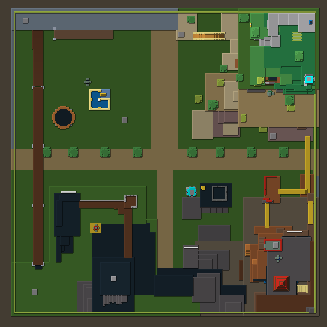
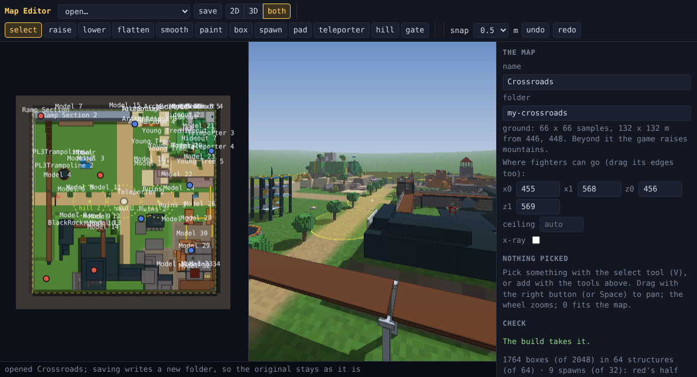

# A Roblox place as a map

A place built in Roblox Studio comes into Fireplace as an arena map: its
parts, their colours, the smooth terrain, the spawn locations and their
teams, and where there is nothing under you, the fall. One command, or one
file dropped on the map editor; no prompt, no hand work, and a report of
everything it left out or changed.

```sh
node tools/roblox.mjs place.rbxl              # writes maps/place/, checked by the build's compiler
node tools/roblox.mjs place.rbxl --brief      # and port/place/: the game's scripts and port.md (below)
node net/play.mjs --arena --map place         # play it with bots
```

Or open `/client/map-editor.html` (`node tools/serve.mjs`), pick **open… >
a Roblox place…** or drop the file on the page, look it over in 2D and in
3D (the arena's own renderer, so what it shows is what a fighter sees),
change what you like, and save it into `maps/`; the check panel offers the
port brief as a zip. The editor runs the same converter in the page.
`maps/crossroads/` is Roblox's own Crossroads, made this way.





## What comes over

Studio saves a place as `.rbxl` (binary) or `.rbxlx` (XML), from **File >
Save to File As**; a model (`.rbxm`, `.rbxmx`) works too.
`tools/rbx-file.mjs` reads both formats into instances, with no dependencies
and no Node, from rbx-dom's unofficial spec of the format (LZ4 chunks decoded
here; zstd ones through Node's zlib, so a zstd file goes through the command
line). `tools/rbx-map.mjs` makes the map:

| In the place | In the map |
| --- | --- |
| a block square to the axes | its box, exactly |
| a wedge, a corner wedge, a cylinder, a ball, a part turned off the axes | cut into columns 0.5 m across, each column's solid rounded to 0.25 m, and runs of equal columns joined: a ramp is stairs no step higher than the arena's 0.5 m, a turned wall a row of posts with no way through |
| a union | its own parts (the place stored inside it), less its negated parts: a doorway cut out of a wall stays a doorway |
| a mesh, or a union saved without its parts | its bounds (counted in the report) |
| a big flat block with nothing under it (a baseplate, a floor on the ground) | the ground, not a box |
| smooth terrain | the ground: the top of each column of solid voxels, its material the surface (grass, rock or sand); water drained, caves and overhangs filled |
| a part's colour (Color3, or a BrickColor in a place from before 2016) | the box's own colour; metal, stone and neon keep a look (`metal#808080`, `rock#...`, `light#...`) |
| a spawn location | a spawn on its top; the two commonest teams are red's and blue's, their flags among their spawns |
| a tool lying in the Workspace (a gear giver) | a weapon pad with the arena's nearest gun, by its name: a sword, a rocket launcher, a sniper rifle |
| sky under the place | a pit, and `"void"`: a fighter below 3 m under the lowest ground dies by falling |
| unanchored parts | kept: a classic place's bricks are held by joints, not anchors (`--anchored` leaves them out) |

Left out, and counted: parts no one collides with (CanCollide off), invisible
ones (walls and triggers), characters, tools, vehicles, anything outside the
Workspace (a game that keeps its maps in storage names them in the report,
and `--from ServerStorage.Maps.Castle` takes one), and every script: the
arena's own modes are the game.

A stud is 0.28 m (Roblox's own figure; `--scale`). The arena's fighter
stands 1.8 m and jumps 1.2 m, where a Roblox character stands about 1.4 m
and jumps 2 m, so a ledge built for a Roblox jump may need a step.

## Fitting the arena

A map's boxes stand square to the axes, and there are at most 2048 of them
(512 until this: a place of a few thousand bricks needed more). Past the
exact joins (boxes of one colour that line up), the converter makes the
place fit a step at a time, stopping at the first step that does: snap
coordinates a little coarser (1 cm up to 50), let colours be a little
apart, and fuse boxes that touch into the box round both when their solid
fills most of it (97% down to 60%), the staggered courses of a brick wall.
A fused box remembers how much of it is solid, so fusing again and again
can't fill a room from its walls; boxes with any gap between them never
fuse, so a door or a window stays open; and what a spawn stands on is never
fused or dropped. If the last step still doesn't fit, the smallest boxes
go, and the report says how many and how big the biggest of them was.

Every one of Roblox's 31 open-source levels
(github.com/Roblox/Old-Open-Source-Levels, MIT), on this 4-core machine.
"Boxes made" is before any joining, "Fused at" the step that fit (blank:
the exact joins were enough), "Left out" the smallest boxes dropped after the
last step:

| Place | Parts | Boxes made | Joined | In the map | Fused at | Left out | Ground, m | Seconds |
| --- | ---: | ---: | ---: | ---: | --- | ---: | --- | ---: |
| Rocket Fight Advanced | 92 | 86 | 73 | 86 |  |  | 68 x 70 | 0.0 |
| Sword Fight in the Dark | 202 | 207 | 201 | 207 |  |  | 96 x 156 | 0.0 |
| Pinball Wizards | 338 | 344 | 343 | 343 |  |  | 162 x 162 | 0.1 |
| ROBLOX Base Wars FPS | 475 | 474 | 426 | 428 |  |  | 242 x 280 | 0.2 |
| Ro-Quake DM17 - The Longest Yard | 506 | 1,082 | 849 | 849 |  |  | 90 x 110 | 0.2 |
| Dodge Stuff | 663 | 659 | 355 | 355 |  |  | 112 x 86 | 0.2 |
| ROBLOX Battle | 954 | 2,195 | 1,784 | 1,784 |  |  | 260 x 90 | 0.4 |
| Timmy and the Killbots | 985 | 987 | 611 | 611 |  |  | 132 x 130 | 0.1 |
| Emerald Forest | 1,423 | 1,926 | 1,623 | 1,623 |  |  | 118 x 162 | 0.3 |
| Crossroads | 1,766 | 2,297 | 1,755 | 1,764 |  |  | 132 x 132 | 0.6 |
| Rocket Arena | 1,791 | 1,772 | 1,176 | 1,184 |  |  | 148 x 148 | 0.2 |
| Chaos Canyon | 2,101 | 2,172 | 1,406 | 1,417 |  |  | 104 x 118 | 0.4 |
| Glass Houses | 2,510 | 3,604 | 3,071 | 1,954 | 25 cm, 85% |  | 132 x 130 | 1.7 |
| Community Construction | 2,551 | 2,666 | 580 | 580 |  |  | 90 x 90 | 0.4 |
| Building with Friends | 2,571 | 2,657 | 571 | 571 |  |  | 90 x 90 | 0.3 |
| Haunted Mansion | 2,735 | 3,504 | 3,277 | 2,021 | 25 cm, 78% |  | 108 x 110 | 1.4 |
| Happy Home in Robloxia | 3,775 | 4,260 | 1,487 | 1,488 |  |  | 354 x 278 | 0.7 |
| Castle Warfare | 4,194 | 4,238 | 2,521 | 2,045 | 25 cm, 78% |  | 136 x 214 | 1.7 |
| Elemental Lake | 4,968 | 5,678 | 4,608 | 1,935 | 25 cm, 78% |  | 298 x 270 | 3.8 |
| Martian Invasion | 5,035 | 21,452 | 11,746 | 2,048 | 50 cm, 60% | 824 | 832 x 630 | 8.2 |
| Roblox HQ 2.0 | 6,637 | 18,475 | 13,390 | 2,048 | 50 cm, 60% | 109 | 162 x 162 | 13.0 |
| Builderman's Vacation Sim! Relax to Survive! | 7,769 | 8,037 | 6,588 | 2,048 | 50 cm, 60% | 1,174 | 646 x 610 | 5.3 |
| Eagles Castle | 7,820 | 7,613 | 4,527 | 2,048 | 50 cm, 60% | 85 | 98 x 88 | 3.9 |
| Four Towers Bridge Battle | 7,913 | 9,311 | 6,547 | 2,048 | 50 cm, 60% | 2,292 | 146 x 216 | 4.1 |
| ROBLOX World Headquarters | 8,083 | 8,599 | 4,669 | 1,626 | 25 cm, 85% |  | 160 x 160 | 3.6 |
| Wishing Castle | 8,204 | 8,195 | 2,955 | 2,023 | 25 cm, 78% |  | 162 x 164 | 2.1 |
| Ninjas vs. Samurai Pagoda Battle | 8,207 | 8,207 | 8,086 | 2,048 | 50 cm, 60% | 1,192 | 104 x 142 | 6.0 |
| Lost Thoughts Fortress | 9,570 | 12,618 | 6,636 | 2,045 | 50 cm, 60% |  | 142 x 140 | 5.8 |
| Pirates Heaven | 12,974 | 17,187 | 10,819 | 2,048 | 50 cm, 60% | 1,007 | 206 x 208 | 10.2 |

29 convert, 22 of them with every box kept. The other two build their level
from scripts when the game runs (Astroland, Zombie Murder): their Workspace
holds nothing but scripts, and the converter says so. Of the seven that
leave boxes out, six leave out nothing bigger than 3 m² a face (Eagles
Castle 85 boxes, none over 0.25 m²); Martian Invasion, 832 m across and
21,452 boxes before joining, leaves out 824, up to 17.5 m².

In the sim, 64 AI fighters on Crossroads (1,764 boxes) step in 0.21 ms a
tick at the median and 0.88 ms at p99, on Eagles Castle (2,048) in 0.30 and
1.4 ms, against Box Canyon's (83 boxes) 0.10 and 0.20, of the tick's 8 ms.

## The game: a port brief

The map comes over by itself; the game's rules can't, because a script is
Luau on Roblox's API. What can be done without a prompt is the brief an
agent ports from, so the port is one prompt on everything rather than one
per question. `--brief` (or the editor's **download the port brief**)
writes, from the same file:

- `scripts/`, every script as a file where it sat, server, client or
  module as Rojo names them (`Workspace/Tower/Bouncer.server.luau`);
- `port.md`: the players (walk speed, jump, health, respawn, what everyone
  spawns with, what lies in the map, what scripts hand out, each with the
  arena's nearest gun), the teams, the leaderboard's stats, every remote
  with the scripts that fire or hear it (in lockstep each becomes a field
  of the input word or nothing), data stores, game passes and developer
  products (a sold edge does not come over), and the Roblox services each
  script leans on, with what stands for each here;
- `assets.json`: every asset id the place names and where, for the
  licence check: sounds, meshes and images are on Roblox's servers, and its
  licensed audio is only for Roblox.

Crossroads' brief: 48 scripts (1,376 lines), everyone spawning with a
sword, slingshot, rocket launcher, trowel, timebomb and superball, KOs and
Wipeouts on the board, no remotes. Miner's Haven's: 710 scripts (54,844
lines), 95 remotes, 10 data stores, three developer products, 1,711 assets.
`port/` is in `.gitignore`: a brief is the place owner's code.

What porting a game takes beyond the brief:

1. **Its rules, written fresh** on a kit here (the arena's modes, Party's
   minigames), by an agent from the brief. The part that can't be
   mechanical.
2. **Maps chosen at run time**, so a converted map plays in a browser and
   in an online room without a build: today it is built into the wasm
   (`--map`). The sim reads the map's sizes from its own head instead of
   compiled constants, the room names a map by its sha256, every client
   fetches and checks it before the first tick (docs/roadmap.md, Engine
   work 3). The step that lets a player drop a place and play it with
   friends the same minute.
3. **Moving parts** (doors, lifts, obbies' platforms): boxes are static.
   A moving box is gameplay state in the region, stepped by the sim.
4. **Meshes**, for a place built of them: their shapes are on Roblox's
   servers, so the owner exports them from Studio (as `.obj`), and a mesh
   reader turns them into boxes the way a turned part is.

## Limits

- Meshes come over as their bounds: a tree of meshes is a block. A mesh's
  shape is an asset on Roblox's servers, not in the file. Big rotated mesh
  rocks (Miner's Haven's map) come out as big rotated boxes cut into columns.
- Terrain is a heightfield: one ground height a 2 m sample. A cave or an
  arch in the terrain is filled; build one as parts.
- Fireplace's ground has four surfaces (grass, rock, sand, metal), so the
  terrain's colours are those four.
- Unions saved before Roblox kept their parts in the file (no `ChildData`)
  are their bounds.
- Nothing of the game comes over: its scripts, sounds, guis, tools and
  data. Bringing a game's rules is a port, written fresh
  ([docs/roadmap.md](roadmap.md), "Bringing maps and games in").

Only bring a place that is yours, or that its owner has licensed for reuse
(Crossroads is Roblox's own, MIT).

## The code

| File | |
| --- | --- |
| `tools/rbx-file.mjs` | a Roblox file into instances: binary (LZ4, zstd given a decoder) and XML, no Node |
| `tools/rbx-map.mjs` | instances into `map.json` and the two images, the report, no Node |
| `tools/rbx-brief.mjs` | the port brief: the scripts as files, port.md, assets.json, no Node |
| `tools/zip.mjs` | the brief as one stored zip, for the editor, no Node |
| `tools/roblox.mjs` | the command line: a file in, `maps/<name>/` out, compiled by `tools/map.mjs`; `--brief` writes `port/<name>/` |
| `client/map-view.mjs` | the editor's 3D view: the arena's renderer on the map being edited |
| `client/map-editor.mjs` | the editor's **a Roblox place…**, drop, and the brief's download |
| `test/roblox.test.mjs` | the reader on Studio's own baseplate (binary and XML agree) and unions, LZ4, terrain, each rule above on a place written in the test, the fit, and the void in the sim |

Box colours are drawing only: the low byte of a box's material word is its
look, bit 7 says the three bytes above are its colour (`materialWord`,
`materialOf` in `tools/map-compile.mjs`), and the sim reads a box's corners
and nothing else. A map with none builds to the same bytes as before.
